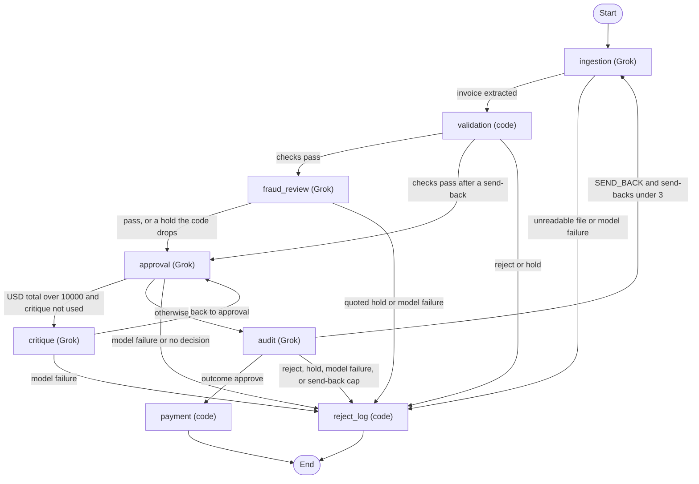

# Acme invoice agents: Grok reads, code decides who gets paid

[](https://github.com/timothytracy/galatiq-case-invoices/actions/workflows/ci.yml)

**Grok reads and questions every invoice, and written rules decide whether it is paid, so no money moves without an audit PASS or a named person's release.**

The system takes one invoice, reads it, checks stock, math, and the payments ledger, and ends in one of three outcomes:

- **Approve.** The invoice is paid.
- **Reject.** The vendor is told exactly what to fix and resend.
- **Hold.** A named person at Acme gets one specific action, such as "verify the price with the vendor."

Grok extracts the fields, reads each invoice for payment fraud, critiques any bill over $10,000, and audits the result. Code makes the final call. A reject or a hold is never paid.

## Results

Every score below replays a committed recording of a live Grok run, so it needs no API key. CI runs all five on every change. Each set was recorded on 2026-11-02 PT.

| Set | What it tests | Score |
|---|---|---|
| 20 samples | The invoices supplied with the brief | 20/20 |
| 21 unseen | New invoices written for this project | 21/21 |
| Ordered ledger | 11 invoice files run in sequence on one shared ledger, so duplicates and revisions are caught | All 11 steps correct |
| Loop set | A large bill through critique and audit, and two pages that state a second amount | 3/3 |
| Fraud set | Payment-fraud cases that code alone would pay | 5/5 |

Across the 41 sample and unseen invoices, 14 are approved, 16 rejected, and 11 held. The unseen, loop, and fraud invoices and their answer keys were written by the author, not by Acme, so treat those scores as regression checks rather than independent tests.


[](docs/demo.mp4)

**[Watch the full demo video (MP4)](docs/demo.mp4).** The review screen replays the recorded run with no API key. It shows approve, reject, and hold outcomes with their reasons and audit trail, pays held invoice 1012 from the hold queue, and refuses a second payment.

## Business impact

The brief describes $2M a year in manual processing, a 30% error rate, and five-day delays.

- **Speed.** About 6 seconds per invoice, against five days by hand. A live run of the 20 samples took 122 s.
- **Cost.** Under one cent of Grok usage per invoice: $0.0059 on the samples and $0.0078 on the unseen set. Details are in [docs/METRICS.md](docs/METRICS.md).
- **Errors.** Every labeled outcome was correct in replay and in every live run on record: three runs each of the samples and unseen sets before fraud review was added, and since then the five recordings, one more samples run, and three more fraud-set runs. No reject or hold was ever paid. Forty-one invoices is a small set, so read this as "no errors seen," not as a measured rate to compare with 30%.
- **People.** 30 of the 41 invoices (73%) need no one at Acme: 14 are paid and 16 go back to the vendor with the fix to make. The other 11 (27%) are holds, and each names one action for one owner instead of starting an email chain.
- **Savings.** Labor saved is the share of invoices that need no person, times today's cost per invoice. That share is 73% on this set. Acme's real mix and volume set the dollar figure, so none is claimed here.

## What changes for Acme

| Today at Acme | What the system does instead |
|---|---|
| Staff type invoice fields by hand from emailed PDFs. | Grok extracts the fields. Code checks each item name against the source text. An OCR fix such as "2O26" to "2026" is kept only when the math reconciles. |
| Staff check an inconsistent legacy inventory database. | One read-only SQLite table. A near-miss name is rejected with "Likely meant WidgetA," never silently substituted. |
| A VP approves by email chain. | Written rules decide. A bill over $10,000 gets one critique, and an audit with read-only tools can only make the decision stricter. A hold names one action for one owner. |
| Staff pay through the banking API. | Payment runs only after an audit PASS or a reviewer's release. A payments ledger blocks a duplicate or a split invoice before money moves. |

Each kind of hold has one owner. These roles are proposed; the brief does not name Acme's teams.

| Hold kind | Codes | Owner | Can a reviewer pay it? |
|---|---|---|---|
| Vendor identity or bank change | `VENDOR_RENAMED`, `NEW_REMITTANCE`, `FRAUD_CLUSTER`, `FRAUD_SUSPECTED` | Accounts payable, with the vendor-master owner | Yes. A second approver is the production next step. |
| Invoice history | `REVISED_INVOICE` | Accounts payable | Yes |
| Invoice history | `DUPLICATE_INVOICE`, `SPLIT_INVOICE` | Accounts payable | No |
| Price | `PRICE_SPIKE` | Purchasing, which owns the PO price | Yes |
| Currency or credit | `NON_USD`, `CREDIT_NOTE` | Finance and accounting | No |
| Extraction trust | `ITEM_NOT_IN_SOURCE` | Accounts payable checks the document | No |
| Review escalation | `CRITIQUE_HOLD`, `AUDIT_ESCALATED` | The approver who replaces the VP email chain | Yes, except at the send-back cap |
| System failure | `SYSTEM_ERROR`, `BAD_REASONING` | Engineering on call reruns the invoice | No |

## Judgment calls

### Invoice 1004: valid, but should it be paid?

The brief says 1004 **passes validation**, and it does: the items are in stock, the math adds up, and every field is present. The brief says nothing about whether it should be **paid**. The vendor's address is 742 Evergreen Terrace, Springfield, the Simpsons' house.

Code alone records the address as a warning and would approve. Fraud review holds it as `FRAUD_SUSPECTED`, quoting the address, so a person verifies the vendor through contact details already on file. A reviewer can release that hold in one step. 1004 is labeled a hold, because a careful accounts-payable clerk would check before paying a cartoon address. The answer key also accepts an approve, because nothing on the page is invalid. Either way, nothing is paid without a check. (The label was a strict approve until fraud review first held 1004; [docs/ANSWER_KEY.md](docs/ANSWER_KEY.md) records the change.)

### Fraud review: what the model catches that code can't

Code alone approves all five invoices in `data/fraud_invoices/`. Three should be held. Two of those, 2124 and 2125, contain no keyword a rule could match: one asks accounts payable to pay a servicing company instead of the vendor, and one moves payment to a differently named party and asks for replies to a free email address. Fraud review held all three, each with a quote that code confirmed is on the page, and passed both legitimate invoices. A fraud-review hold that cannot be traced to text on the page is dropped.

### Invoice 2106: a clean bill the reviewers kept doubting

2106 is a clean $11,500 bill that should be paid. At first Grok's critique raised a stock concern that was not real, and the audit called its dates future dates, so it was held on every run. The fix, in [PR #14](https://github.com/timothytracy/galatiq-case-invoices/pull/14), gives the critique and audit the facts code has already checked, and drops, with a log entry, only the concerns that contradict them. Giving the critique lookup tools broke 2106 again ([PR #20](https://github.com/timothytracy/galatiq-case-invoices/pull/20), closed), so tools went to the audit only ([PR #21](https://github.com/timothytracy/galatiq-case-invoices/pull/21), [PR #27](https://github.com/timothytracy/galatiq-case-invoices/pull/27)).

### Duplicates: built, not cut

Duplicate detection almost made the cut list. But a system that pays every invoice it is shown pays the same bill twice whenever a vendor resends it, sends it in another format, or sends a revised copy. So the system keeps a lasting payments ledger. On arrival it catches an exact duplicate, the same invoice in another format, a revision, or a split, where invoices under $10,000 from one vendor within 30 days add up to more than $10,000. Any match is a hold. A database constraint blocks a second payment even if every check misses.

## What I cut, and why

| Cut | Why | Production next step |
|---|---|---|
| Email ingestion | Parsing mailboxes adds nothing to the decision logic. The pipeline takes one file, which is what an inbox watcher would hand it. | A mailbox watcher that drops attachments into the same command. |
| OCR for scanned PDFs | All provided PDFs have a text layer. OCR-style damage ("2O26") is handled at the text level. | Grok vision or Tesseract for image-only PDFs. |
| Currency conversion | Paying from a stale exchange rate is a real money risk. Non-USD invoices are held, never converted. | A dated rate feed, with finance confirming the rate on the hold. |
| A vendor master (bank account on file) | The brief supplies no vendor data. Renames and bank changes are caught from the invoice text. | A vendor table, so a bank change is a code check, not a judgment call. |
| Purchase-order matching | The brief supplies no PO data. Stock and reference prices stand in for it. | Match each line to an open PO line for item, quantity, and price. |
| Live inventory | Stock is a fixed snapshot so each invoice gets the same answer whatever ran before it. | Read stock from the system of record at decision time. |
| A second approver | One reviewer can release a vendor-identity or bank-change hold. | Two-person approval for those holds. |
| Multi-process safety | The prototype runs one process at a time. | A database lock or queue around the split check and payment. |
| Auth and a shared review queue | The brief says run locally. Review notes are local files. | Sign-in, roles, and a durable queue. |
| Memory from human reviews | A reviewer's decision is recorded, but the agents never read it. | Let a reviewer mark a resolution, such as a confirmed vendor rename, for later runs to remember. |
| Partial balance or deposit | The balance-due check reads only a few printed labels. Other wordings can be paid in full. | A person checks any bill that shows a partial balance or deposit. |

## For engineers

### Quick start

Python 3.12 or newer. No API key needed.

```bash
python3 -m venv .venv && source .venv/bin/activate
pip install -r requirements-dev.txt
python3 -m pytest
python3 scripts/eval.py --replay recordings/samples.jsonl
python3 main.py --invoice_path=data/invoices/invoice_1001.txt --reset-ledger --replay recordings/samples.jsonl
streamlit run ui/app.py
```

That runs the tests, scores the 20 samples from the recorded run (exit 0 at 20/20), walks one invoice through every agent, and opens the review screen. Run these from the repository root.

### Agents

`graph.py` wires a LangGraph `StateGraph`. Ingestion, fraud review, approval, critique, and audit call Grok. Validation, payment, and `reject_log` are code. Fraud review runs once, after validation passes. Critique returns to approval. Audit can send the extraction back to ingestion. Holds and rejects both end at `reject_log`, and nothing on that path is paid.



### Why code decides

Grok does the reading and the judging. Code turns those findings into approve, reject, or hold. Paying money needs the same invoice to get the same answer every time, traceable to a rule. So a model can make a decision stricter but never looser, and text inside an invoice cannot talk the system into paying it. The trade-off is less model autonomy. In return, no reject or hold was paid in any labeled run. The full policy is in [docs/DESIGN.md](docs/DESIGN.md).

### Replaying every set

```bash
python3 scripts/eval.py --replay recordings/samples.jsonl
python3 scripts/eval.py --invoices data/extra_invoices --answer-key data/extra_answer_key.json --replay recordings/unseen.jsonl
python3 scripts/eval.py --ordered --replay recordings/ordered.jsonl
python3 scripts/eval.py --invoices data/loop_invoices --answer-key data/loop_answer_key.json --replay recordings/loop.jsonl
python3 scripts/eval.py --invoices data/fraud_invoices --answer-key data/fraud_answer_key.json --replay recordings/fraud.jsonl
```

Each exits 0 on a perfect score. These are the five CI runs, with no API key. The unseen scorer checks the outcome plus the primary reason code, or a listed alternate. Add `--verbose` to see each stage's JSON record.

In the ordered run, 1004 is held by fraud review, so the ledger ends with two paid rows (1001 and 1011), and 1004's revision is still a `REVISED_INVOICE` hold. If 1004 were approved instead, the ledger would have three rows, which the scenario also accepts.

In the loop set, 2117, a clean $10,625 bill, went through critique and audit and was paid. 2118 and 2120 were held at validation because each page states a second amount (a total in words, or a balance due after a deposit).

### One invoice, step by step

```bash
python3 main.py --invoice_path=data/invoices/invoice_1001.txt --reset-ledger --replay recordings/samples.jsonl
```

`--replay` answers each Grok call from the recorded run, so the same code runs with no network. `--reset-ledger` deletes `payments.db` first, so the invoice is not seen as already paid. The output is one JSON record per stage (ingestion, validation, fraud review, approval, audit, payment), then `Paid 5000.00 to Widgets Inc.` and a final `result` record. Try `invoice_1002.txt` for a stock reject or `invoice_1012.txt` for a hold.

With no `XAI_API_KEY` set, and no `--replay` or `--record`, `main.py` falls back to the recordings on its own and says so. A file in no recording exits 1 and asks for a key. With a key set (see `.env.example`), the same command calls Grok, and `python3 scripts/eval.py` scores the samples live. `scripts/eval.py` never falls back; without a key or `--replay` it stops.

`inventory.db`, `payments.db`, and `logs/` live in the repository root, or in `INVOICE_DATA_DIR` when it is set, so the command line, the review screen, and a release all read the same ledger. `--reset-db` rebuilds inventory from the seed, `--reset-ledger` deletes the payments ledger and its release records, and `--reset` does both.

### Releasing a hold

The review screen is `streamlit run ui/app.py`. With no key it uses replay, which covers every provided invoice. A reviewer releases a hold with `approve_and_pay`. This demo uses a temporary ledger and no model:

```bash
python3 scripts/approve_hold_demo.py --demo
```

`invoice_1012.txt`, a `VENDOR_RENAMED` hold, is paid: `Paid 9975.00 to QuickShip Distributers (formerly FastShip Ltd.)`. `invoice_1002.txt`, a stock reject, stays unpaid with reason `NOT_PAYABLE`.

### Where to read next

- [REQUIREMENTS.md](REQUIREMENTS.md): the original brief, unchanged
- [docs/DESIGN.md](docs/DESIGN.md): each agent, the approve, reject, and hold rules, warnings, and the settings
- [docs/METRICS.md](docs/METRICS.md): replay and live-run numbers
- [docs/ANSWER_KEY.md](docs/ANSWER_KEY.md), [docs/EXTRA_ANSWER_KEY.md](docs/EXTRA_ANSWER_KEY.md), and [docs/FRAUD_ANSWER_KEY.md](docs/FRAUD_ANSWER_KEY.md): the labeled outcomes
- [docs/graph.md](docs/graph.md): the generated graph
- [recordings/README.md](recordings/README.md): how the five recordings were made
