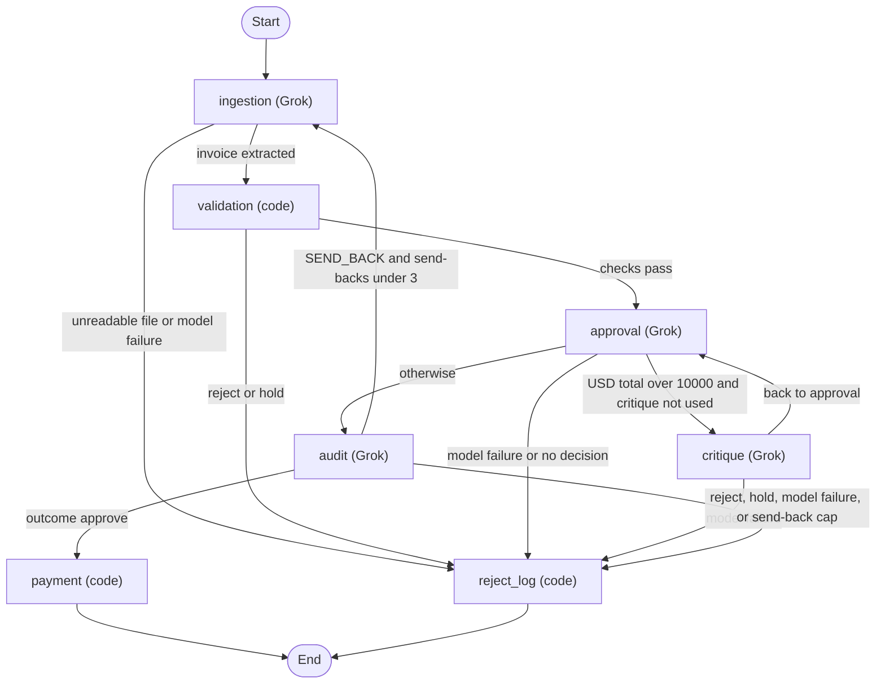

# Acme invoice agents: Grok reads, code decides who gets paid

[](https://github.com/timothytracy/galatiq-case-invoices/actions/workflows/ci.yml)

**Grok reads and questions every invoice, and written rules decide whether it is paid, so no money moves without an audit PASS or a named person's release.**

The pipeline reads one invoice, checks stock, math, and the payments ledger, and either pays it or stops with a reason. Grok extracts the fields, critiques a USD total over $10,000, and audits. Code chooses approve, reject, or hold. Of the 41 labeled invoices, 15 are approved, 16 are rejected, and 10 are held. The loop set adds 3 more: one approved and two held. The warning set adds 3 more: two labeled holds that only the audit's judgment can catch, and one approve. The pipeline never pays an invoice it rejected or held. A reviewer can release some holds for payment.

Replay of the five committed recordings, no API key, recorded on 2026-11-02 PT with `--as-of 2026-11-01`:

| Set | Score |
|---|---|
| 20 samples | 20/20 |
| 21 unseen | 21/21 |
| Ordered ledger | 11 steps ok, ledger matches |
| Loop set | 3/3 |
| Warning set | 1/3 |

Live runs the same day: samples 19/20, 20/20, and 20/20; unseen 21/21 three times; the ordered ledger ok; the loop set 3/3; and the warning set 1/3 three times. The samples miss was invoice 1009, which extraction read so that validation rejected it for `MISSING_FIELD` instead of `BAD_QUANTITY`. It is still a reject and unpaid, and the audit never ran on it. The first samples recording had the same miss and was recorded again. On the warning set, the audit never escalated 2121 or 2122, so both were paid. See [Warning holds](#warning-holds). The 21 unseen invoices, the warning set, and their answer keys were written by the author, not by Acme, so treat those scores as regression checks rather than independent tests.

### Quick start

Python 3.12 or newer. CI uses 3.12. No API key needed.

```bash
python3 -m venv .venv && source .venv/bin/activate
pip install -r requirements-dev.txt
python3 -m pytest
python3 scripts/eval.py --replay recordings/samples.jsonl
python3 main.py --invoice_path=data/invoices/invoice_1001.txt --reset-ledger --replay recordings/samples.jsonl
streamlit run ui/app.py
```

That runs the test suite, scores the 20 samples from the recorded Grok run (exits 0 at 20/20), walks one invoice through every agent, and opens the review screen in Replay mode. The same `main.py` command with no key and no `--replay` falls back to the recordings on its own. The databases and logs always go in the repository root (or `INVOICE_DATA_DIR`). Invoice and recording paths are relative to where you run, so the commands above assume the repository root. How each agent works, and why code decides, is in [docs/DESIGN.md](docs/DESIGN.md).


The review screen shows ten sample invoices from that recorded run.

[](docs/demo.mp4)

**[Watch the full demo video (MP4)](docs/demo.mp4)**

Demo: the review screen replays the recorded Grok run with no API key, shows approve, reject and hold outcomes with their reasons and audit trail, pays held invoice 1012 from the hold queue, and refuses a second payment.

### Business impact

The brief describes $2M a year in manual processing, a 30% error rate, and five-day delays.

- **Speed.** In the live runs on 2026-11-02 PT, an invoice took 3.57–4.38 s, against five days by hand.
- **Cost.** Grok cost $0.005493–$0.006082 per invoice in the recorded runs. Each figure is that run's wall time or cost divided by its invoice count. The runs are in [docs/METRICS.md](docs/METRICS.md).
- **Errors.** All 41 labeled outcomes were correct in replay. In three live runs of each set, one samples run gave 1009 the wrong reject reason; it was still rejected and unpaid. No invoice labeled reject was paid. Two invoices labeled hold, 2121 and 2122 in the warning set, were paid in every run, because the audit passed them. Forty-four invoices is a small set, so read this as a few errors seen, not as a measured rate to compare with 30%.
- **People.** 31 of the 41 invoices, 76%, need no one at Acme. The 15 approves are paid. The 16 rejects go back to the vendor with the fix to make. The other 10, 24%, are holds. Each hold names one action for a person, such as confirming a currency or a bank-account change, instead of starting an email chain.
- **Savings.** The labor saved is the share of invoices that need no person times today's cost per invoice. On this set that share is 76%. Acme's real mix and volume set the dollar figure, so none is claimed here.

### What changes for Acme

| Today at Acme | What the system does instead |
|---|---|
| Staff type invoice fields by hand from emailed PDFs. | Grok extracts the fields. Code checks each item name against the source text, and an OCR fix is kept only when the math reconciles. A name that is not in the text is a hold, not a guess. |
| Staff check a legacy inventory database that is inconsistent. | One SQLite table, opened read-only. Names match after case, spaces, and hyphens are normalized. Quantities are summed per item. A near-miss name is rejected with "Likely meant X." and is never substituted. |
| A VP approves by email chain. | Code applies written rules. A USD total over $10,000 gets one critique, and an audit with read-only tools can only tighten. A hold names one action for one owner, and `approve_and_pay` records the release. |
| Staff pay through the banking API. | `mock_payment` runs only after an audit PASS or a reviewer release. The payments ledger blocks a duplicate or a split before money moves. |

Each kind of hold has one owner. These roles are proposed. The brief does not name Acme's teams.

| Hold kind | Codes | Owner | Can a reviewer pay it? |
|---|---|---|---|
| Vendor identity or bank change | `VENDOR_RENAMED`, `NEW_REMITTANCE`, `FRAUD_CLUSTER` | Accounts payable, with the vendor-master owner | Yes. A second approver is the production next step. |
| Invoice history | `REVISED_INVOICE` | Accounts payable | Yes |
| Invoice history | `DUPLICATE_INVOICE`, `SPLIT_INVOICE` | Accounts payable | No |
| Price | `PRICE_SPIKE` | Purchasing, which owns the PO price | Yes |
| Currency or credit | `NON_USD`, `CREDIT_NOTE` | Finance and accounting | No |
| Extraction trust | `ITEM_NOT_IN_SOURCE` | Accounts payable checks the document | No |
| Review escalation, including an audit hold on a quoted fraud-signal or price warning | `CRITIQUE_HOLD`, `AUDIT_ESCALATED` | The approver who replaces the VP email chain | Yes, except at the send-back cap |
| System failure | `SYSTEM_ERROR`, `BAD_REASONING` | Engineering on call reruns the invoice | No |

### Invoice 2106

Invoice 2106 is the one unseen test invoice that should be approved, and on Oct 31 it was held on every run. Grok's critique raised a stock concern that was not real (WidgetB, 8 against 10), and the audit called its dates future dates. On Nov 1, [PR #14](https://github.com/timothytracy/galatiq-case-invoices/pull/14) gave the critique and audit prompts the code's own findings, and it drops, with a log entry, only the concerns that contradict them. The unseen set then scored 21/21 on all three runs.

When we tried Grok lookup tools on the critique in [PR #20](https://github.com/timothytracy/galatiq-case-invoices/pull/20), 2106 broke again. It first hit the call and round limits, then got a fresh critique hold, until the critique's tools were cut to one lookup per item. That PR was closed, and the tools went to the audit step only in [PR #21](https://github.com/timothytracy/galatiq-case-invoices/pull/21). With audit tools on by default in [PR #27](https://github.com/timothytracy/galatiq-case-invoices/pull/27), the unseen set scored 21/21 three times. On one of those runs 2106 hit the call limit on the way and still got the right answer.

### Warning holds

A warning, such as a single fraud signal or a price that differs from the reference, does not change the outcome on its own. The audit may now weigh one into a hold for a person. It must cite a `FRAUD_SIGNAL`, or a `PRICE_VARIANCE` above the reference price, that code raised on this invoice. It must also give the innocent reading and quote page text that makes that reading unlikely. Code checks every part of that: the code, the price direction, the quote being on the page, the quote being more than the line that raised the warning, and its length. A case that fails any check is dropped and logged as an `AUDIT_NOTE`, and the invoice is decided as before. A case that passes is an `AUDIT_ESCALATED` hold that a reviewer can release.

The warning set in `data/warning_invoices/` was labeled before the prompt was written. 2121 is wire-only and says "Do not call our office to confirm payment details", with only a free-mail contact. 2122 prices GadgetX 40% over reference "per phone agreement" and says not to compare it to the PO. Both are labeled hold. 2123 is wire-only with a PO and banking details on file, and is labeled approve.

In the recorded run and in three live runs, the audit passed all three, so the set scored 1/3 each time. On 2121 it wrote that no text on the invoice made the wire terms unlikely. On 2122 it took the phone-agreement note as the innocent reading. The code path works, and fake-model tests show a valid case is held and a bad one is dropped. But this model, with this prompt, did not use it. The prompt was not changed to chase the labels. Replay with `python3 scripts/eval.py --invoices data/warning_invoices --answer-key data/warning_answer_key.json --replay recordings/warning.jsonl`. It exits 1, so CI does not run it.

The audit can only weigh warnings code already raised, and fraud signals come from keyword matching. A payment redirection with no keywords, such as "settlement to the account on the attached remittance advice", raises no `FRAUD_SIGNAL`, so it is never eligible.

### What I cut, and why

| Cut | Why | Production next step |
|---|---|---|
| Email ingestion | The brief's invoices arrive by email, but parsing mailboxes adds nothing to the decision logic. The pipeline takes one file, which is what an inbox watcher would hand it. | A mailbox watcher that drops attachments into the same CLI path. |
| OCR for scanned PDFs | All provided PDFs have a text layer. OCR-style damage ("2O26") is handled at the text level. | Grok vision or Tesseract for image-only PDFs, feeding the same extraction step. |
| Currency conversion | Paying from a static, stale FX rate is a real money risk, and it changes no outcome on this data. Non-USD invoices are held, never converted. | A dated rate feed, with finance confirming the rate on the hold. |
| A vendor master (bank account on file) | The brief supplies no vendor data. Renames and bank changes are caught from the invoice text. | A vendor table with the bank account on file, so a bank change is a code check, not a judgment call. |
| Purchase-order matching | The brief supplies no PO data. Stock and reference prices stand in for the PO check. | Match each invoice line to an open PO line for item, quantity, and price before approval. |
| Live inventory | Stock is a read-only snapshot so each invoice gets the same answer whatever ran before it. | Read stock and PO coverage from the system of record at decision time. |
| A second approver | One reviewer can release a vendor-identity or bank-change hold. | Two-person approval for those holds. |
| Multi-process safety | Two workers could each pay half of a split invoice. The prototype runs one process at a time. | A database lock or queue around the split check and payment. |
| Auth and a shared review queue | The brief says run locally. Review notes are local files. | Sign-in, roles, and a durable queue so a release is attributed to a person. |
| A dedicated fraud agent | Fraud signals are caught by validation rules and the approval and critique steps, which covers every fraud case in this data. A separate agent was not needed for an MVP. | A fraud agent with its own prompt, tools, and labeled set, so it can be evaluated and improved without touching the rest of the pipeline. |
| Offline mode (fake model) | Not in the brief, and replay already runs every provided invoice with no key. The fake model stays as a test fixture. | None. |
| Memory from human reviews | Each run starts fresh. A reviewer's decision and note are recorded, but the agents never read them. | When a reviewer resolves a hold with a justification, they choose whether the agents should remember it. A kept lesson, such as a confirmed vendor rename, goes into the context of later runs. |

Duplicate detection almost made this list. At first I judged each invoice file on its own content and listed duplicates as a known limitation. Then I thought about what that means in practice: a system that pays every invoice it is shown pays the same bill twice whenever a vendor resends it, sends it in another format, or sends a revised copy, and over time that loses real money. So I built a lasting payments ledger instead. Validation checks it on arrival for an exact duplicate, the same invoice in a different format, a revision, or a split, where invoices under $10,000 from one vendor within 30 days add up to more than that. Any match is a hold, not a second payment. The audit step can read the same ledger before payment, and a unique index on vendor and invoice number blocks a second payment even if both checks miss.

## Agents

`graph.py` wires a LangGraph `StateGraph`. Each agent is a node. Ingestion, approval, critique, and audit call Grok. Validation, payment, and `reject_log` are code. Critique returns to approval. Audit can send the extraction back to ingestion. Holds and rejects both end at `reject_log`. Nothing on that path is paid. Payment runs only after an audit PASS on an approve.



### Why code decides

Grok does the reading and the judging: it extracts the fields, lists the risks, critiques a large bill, and audits with tools. Code decides reject and approve. Within the warning band, the audit may turn an approve into a hold for a person. It does this by citing a fraud-signal or price-variance warning that code raised on this invoice, giving the innocent reading, and quoting page text that code verifies. So the same findings give the same outcome, except that an approve carrying one of those warnings may become a reviewer-releasable hold. The model can never cause a payment or a reject, and text inside an invoice cannot talk the system into paying it. Every answer stays traceable to a rule or to a quoted line. The trade-off is limited model autonomy. No invoice the pipeline rejected or held was paid in any run.

## How to run

Replay first. No API key.

```bash
python3 -m venv .venv
.venv/bin/pip install -r requirements.txt
source .venv/bin/activate
python3 scripts/eval.py --replay recordings/samples.jsonl
python3 scripts/eval.py --invoices data/extra_invoices --answer-key data/extra_answer_key.json --replay recordings/unseen.jsonl
python3 scripts/eval.py --ordered --replay recordings/ordered.jsonl
```

Each of those three exits 0 when the score is perfect. The unseen scorer checks the outcome plus the primary reason code, or a listed alternate code from the answer key. Add `--verbose` to also see each stage's JSON record. CI runs these three and the loop replay below, four in all, and does not set an API key.

**Loops in action.** In the recorded live run of the loop set in `data/loop_invoices/`, the loops ran on one invoice and changed nothing. 2117, a clean $10,625 bill, went through critique and audit. The critique asked for a hold because the due date, 2026-10-15, was "after today". Today was 2026-11-01, so the fact guard set that claim aside, the audit passed, and it was paid. 2118 and 2120 were held at validation, before any loop ran, because each page states a second amount. When Grok read 2118's total from the words ($10,250) instead of the printed $10,520, the hold still caught it. Fake-model tests cover the printed-total read, and the case where 2120's $8,000 balance is read as the total, which is a `TOTAL_MISMATCH` reject and still unpaid. Replay with `python3 scripts/eval.py --invoices data/loop_invoices --answer-key data/loop_answer_key.json --replay recordings/loop.jsonl` (CI does too).

### Reviewer quick path

To watch one invoice go through every agent with no API key:

```bash
python3 main.py --invoice_path=data/invoices/invoice_1001.txt --reset-ledger --replay recordings/samples.jsonl
```

`--replay` answers each Grok call from the recorded live run, so the same code runs with no network. `--reset-ledger` deletes `payments.db` first, so the invoice is not seen as already paid. The output is one JSON record per stage: ingestion, validation, approval, audit with its tool calls, and payment. Then comes `Paid 5000.00 to Widgets Inc.` and a final `result` record with the outcome. Any file in `data/invoices/` works the same way. Try `invoice_1002.txt` for a stock reject or `invoice_1012.txt` for a hold.

`inventory.db`, `payments.db`, and `logs/` live in the data folder: the repository root, or `INVOICE_DATA_DIR` when it is set. The folder you run from does not change it, so the command line, the review screen, and a release all read the same ledger. `--reset-db` deletes `inventory.db` and rebuilds it from the seed. `--reset-ledger` deletes `payments.db`, including the release records stored there, so a held invoice must be rerun before it can be approved. `--reset` does both. `scripts/eval.py --reset` and `--reset-db` rebuild inventory only; eval does not use `payments.db`. They do not change `recordings/`, `data/`, or `logs/`.

With no `XAI_API_KEY` in the environment or in `.env`, `python3 main.py --invoice_path=...` falls back to the recordings. It prints `No XAI_API_KEY set. Using replay (recorded Grok runs). Set XAI_API_KEY to run live.` and replays whichever of `recordings/samples.jsonl`, `recordings/unseen.jsonl`, `recordings/loop.jsonl`, or `recordings/warning.jsonl` has that invoice. A file in neither exits 1 and asks for a key. `recordings/ordered.jsonl` is not used. This fallback runs only when you pass no `--replay` or `--record` and `XAI_MODE` is unset. With a key set, that same command calls Grok. `scripts/eval.py` does not fall back.

With a key already set (see `.env.example`; leave the key out of the command):

```bash
python3 scripts/eval.py
```

That scores the 20 samples live. Exit 0 means 20/20. Without a key, that command stops.

The review screen is `streamlit run ui/app.py`. With no key it uses replay, which covers every provided invoice. A new invoice needs `XAI_API_KEY`.

A reviewer releases a hold with `approve_and_pay`. This demo replays two recorded invoices, then tries to release each. It uses a temporary ledger and does not call the model.

```bash
python3 scripts/approve_hold_demo.py --demo
```

`invoice_1012.txt` is a `VENDOR_RENAMED` hold, and it is paid: `Paid 9975.00 to QuickShip Distributers (formerly FastShip Ltd.)`. `invoice_1002.txt` is a stock reject, and it stays unpaid with reason `NOT_PAYABLE`. Both keep their pipeline outcome.

## Where to read next

- [REQUIREMENTS.md](REQUIREMENTS.md) — the original brief, unchanged
- [docs/DESIGN.md](docs/DESIGN.md) — the agents, why code decides, approve, reject, hold, warnings, and the knobs
- [docs/METRICS.md](docs/METRICS.md) — replay and live-run numbers
- [docs/ANSWER_KEY.md](docs/ANSWER_KEY.md), [docs/EXTRA_ANSWER_KEY.md](docs/EXTRA_ANSWER_KEY.md), and [docs/WARNING_ANSWER_KEY.md](docs/WARNING_ANSWER_KEY.md) — the labeled outcomes
- [docs/graph.md](docs/graph.md) — the generated graph
- [recordings/README.md](recordings/README.md) — how the five recordings were made
