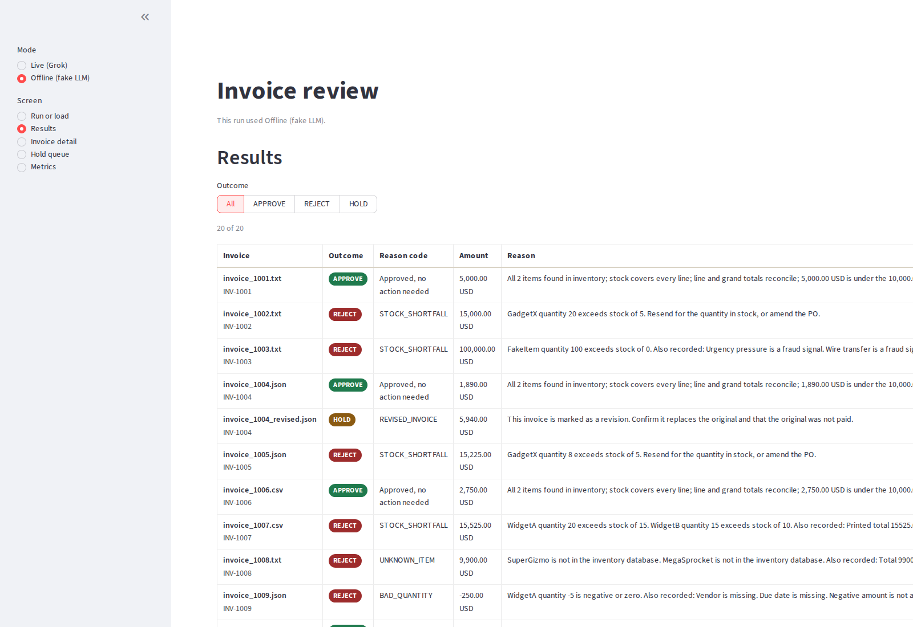

# Galatiq Case: Invoice Processing Automation

[](https://github.com/timothytracy/galatiq-case-invoices/actions/workflows/ci.yml)

## Results

Replay of the six committed recordings, with no API key, on 2026-11-01 PT:

| Set | Tools | Score |
|---|---|---|
| 20 samples | on | 20/20 |
| 21 unseen | on | 21/21 |
| Ordered ledger | on | 11 steps ok, ledger matches |
| 20 samples | off (`XAI_TOOLS=0`) | 20/20 |
| 21 unseen | off | 21/21 |
| Ordered ledger | off | 11 steps ok, ledger matches |

Live runs on 2026-11-01 PT matched the keys every time (samples 20/20 x3, unseen 21/21 x3, ordered ok).



The screenshot is the review screen with ten of the twenty sample invoices from the replay of the recorded Grok run (2026-11-01 PT) loaded, chosen because their full reasons fit on screen: 1001, 1002, 1003, 1006, 1008, 1011 (pdf and text), 1012 (pdf and text), and 1014.

### Business impact

The brief describes five-day payment delays. In the live runs on 2026-11-01 PT, each invoice took about 3 to 4 seconds with audit tools (2.85–3.90 s) and about 2.5 seconds without (2.40–2.57 s), at $0.0049–$0.0064 and $0.0026–$0.0028 per invoice. Times are whole-run wall time divided by invoice count, invoices run one after another; costs are run cost divided by invoice count; details in [docs/METRICS.md](docs/METRICS.md).

Of the 41 labeled invoices, 31 are decided automatically and 10 are held for a person. No invoice the answer keys mark as bad is paid.

## Quick start

Replay first. No API key.

```bash
python3 -m venv .venv
.venv/bin/pip install -r requirements.txt
source .venv/bin/activate
python3 scripts/eval.py --replay recordings/samples_tools.jsonl
python3 scripts/eval.py --invoices data/extra_invoices --answer-key data/extra_answer_key.json --replay recordings/unseen_tools.jsonl
python3 scripts/eval.py --ordered --replay recordings/ordered_tools.jsonl
XAI_TOOLS=0 python3 scripts/eval.py --replay recordings/samples.jsonl
XAI_TOOLS=0 python3 scripts/eval.py --invoices data/extra_invoices --answer-key data/extra_answer_key.json --replay recordings/unseen.jsonl
XAI_TOOLS=0 python3 scripts/eval.py --ordered --replay recordings/ordered.jsonl
```

Each of those six exits 0 when the score is perfect. CI runs the same six after the tests. A run creates `inventory.db` from the seed when the file is missing.

`--reset-db` deletes `inventory.db` and rebuilds it from the seed. `--reset-ledger` deletes `payments.db`, including the release records stored there, so a held invoice must be rerun before it can be approved. `--reset` does both. `scripts/eval.py --reset` and `--reset-db` rebuild inventory only; eval does not use `payments.db`. They do not change `recordings/`, `data/`, or `logs/`.

A live run needs `XAI_API_KEY` in the environment or in `.env` (see `.env.example`).

```bash
cp .env.example .env
# set XAI_API_KEY in .env
python3 main.py --invoice_path=data/invoices/invoice_1001.txt
python3 scripts/eval.py
```

`python3 main.py --invoice_path=<file>` prints one JSON object per stage and writes the same records under `logs/`. A missing key exits non-zero before any invoice is read. The model is `XAI_MODEL`, default `grok-4.20-0309-non-reasoning`, called through the OpenAI SDK at `https://api.x.ai/v1`. `python3 scripts/eval.py` scores the 20 sample invoices against `data/answer_key.json` and needs the key. It exits 0 only when every outcome and primary reason code match.

## Architecture

`graph.py` wires a LangGraph `StateGraph`. The stage bodies are ordinary functions under `pipeline/`: ingestion, validation, approval, critique, audit, payment, and `reject_log`. Each invoice format has a reader under `parsers/`. The picture of the edges is [docs/graph.md](docs/graph.md).

Code decides. `outcome_from_findings` turns findings into approve, reject, or hold. Reject wins over hold, and hold wins over approve. The model extracts fields, writes a critique on a USD total over $10,000, and returns an audit verdict. Critique and audit can only tighten. Payment runs only after an audit PASS on an approve. The walkthrough is [SOLUTION.md](SOLUTION.md).

## Key decisions

The full set is [docs/DECISIONS.md](docs/DECISIONS.md). The policy text is [docs/DECISION_POLICY.md](docs/DECISION_POLICY.md).

- Audit tools are on by default. Unset, empty, `1`, `true`, `yes`, and `on` leave them on. `0`, `false`, `off`, and `no` turn them off. Any other value stops the run at startup.
- Audit may call `lookup_item`, `recompute_totals`, `get_policy_rule`, and, when tools are on, `check_payment_ledger`. The calls are capped at 3 rounds and 8 calls, and each call is logged. The tools read inventory, totals, policy, and the payment ledger. They can only tighten a decision. They do not pay.
- A hit on the cap gets one final model reply with no tools. If that reply fails, the invoice is a `SYSTEM_ERROR` hold and nothing is paid.
- `payments.db` records each accepted payment. The same vendor and invoice number is a `DUPLICATE_INVOICE` hold. A same-vendor cluster inside the split window that crosses the threshold is a `SPLIT_INVOICE` hold. Scored eval gives each invoice a fresh ledger. `scripts/eval.py --ordered` shares one ledger.
- Replay feeds saved replies through this code. It needs no API key and no network. A miss is a `SYSTEM_ERROR` hold and nothing is paid. Record and replay use the `as_of` date in the recording header.

## Where to read next

- [REQUIREMENTS.md](REQUIREMENTS.md) — the original brief, unchanged
- [SOLUTION.md](SOLUTION.md) — how the pipeline decides
- [docs/DECISIONS.md](docs/DECISIONS.md) — the calls this prototype makes
- [docs/DECISION_POLICY.md](docs/DECISION_POLICY.md) — approve, reject, hold, and warnings
- [docs/ANSWER_KEY.md](docs/ANSWER_KEY.md) and [docs/EXTRA_ANSWER_KEY.md](docs/EXTRA_ANSWER_KEY.md) — the labeled outcomes
- [docs/METRICS.md](docs/METRICS.md) — replay and live-run numbers
- [docs/QA.md](docs/QA.md) — short answers
- [docs/DEMO.md](docs/DEMO.md) — a 10 to 15 minute walkthrough
- [docs/graph.md](docs/graph.md) — the generated graph
- [recordings/README.md](recordings/README.md) — how the six recordings were made
