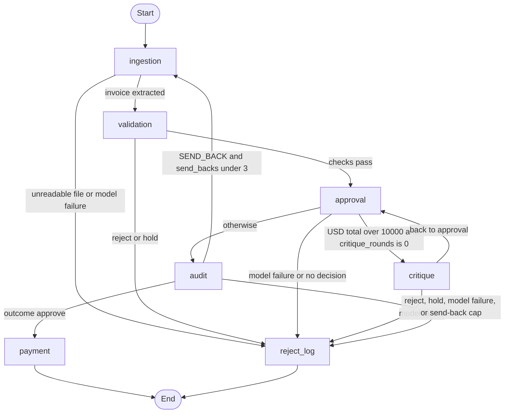
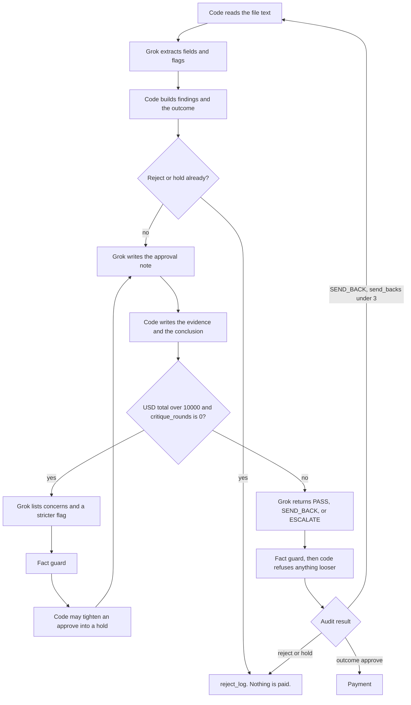
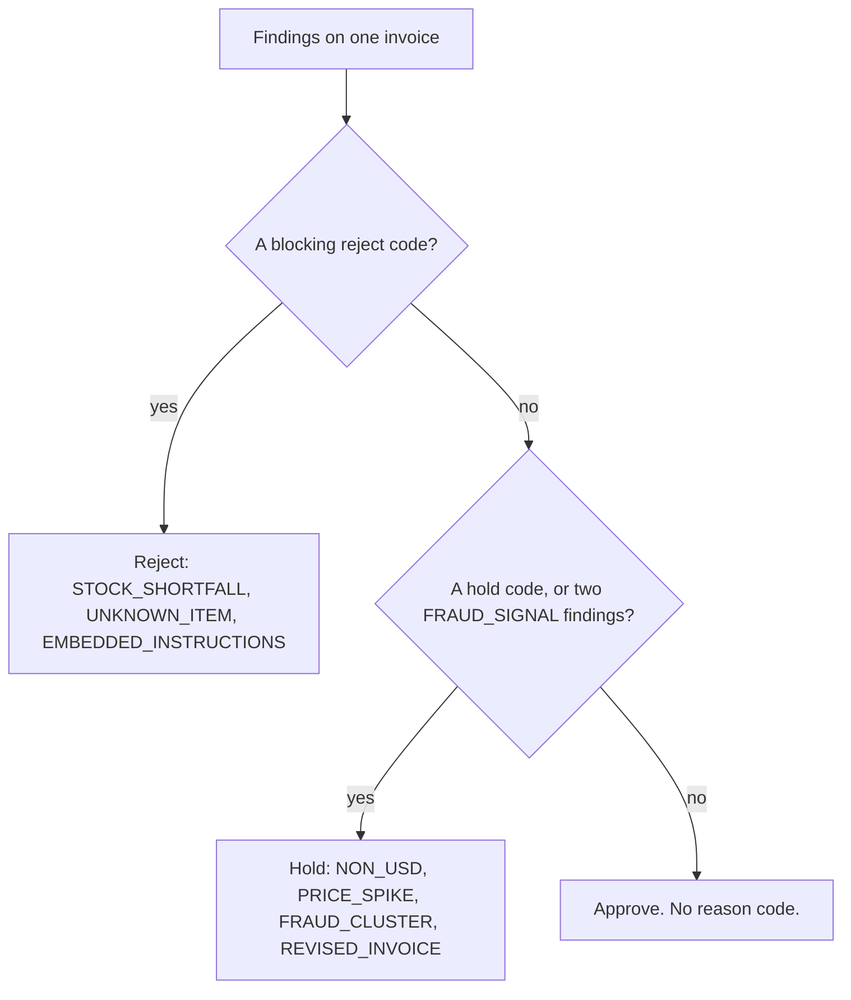
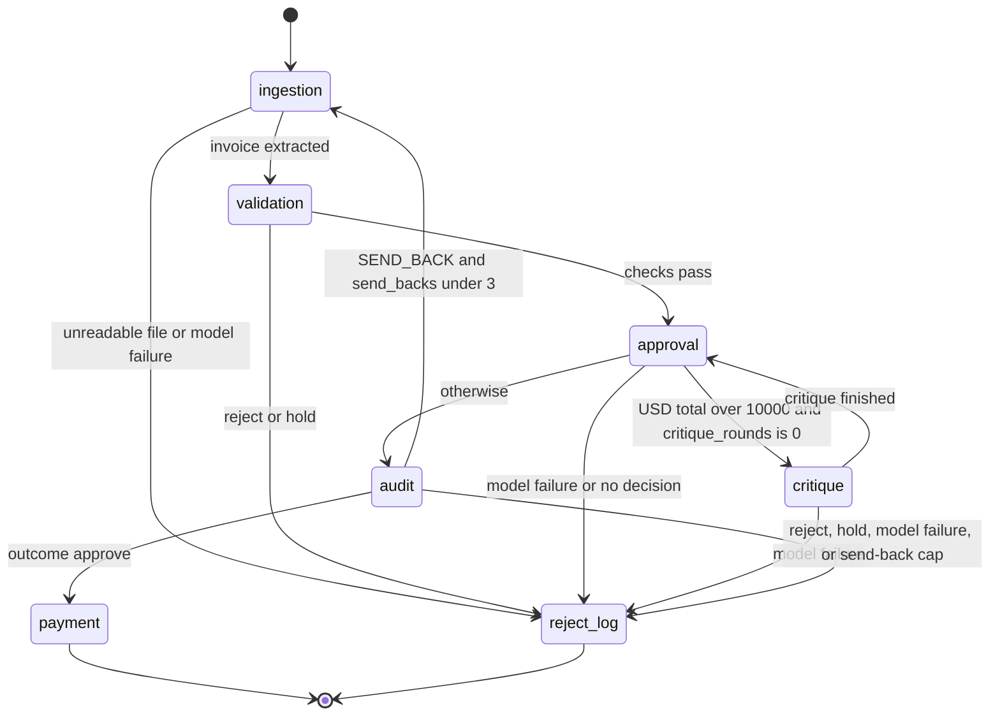
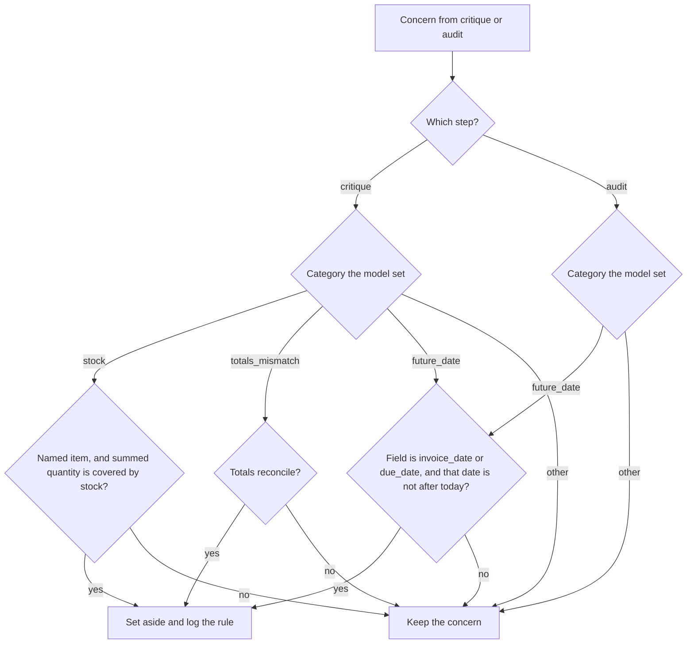
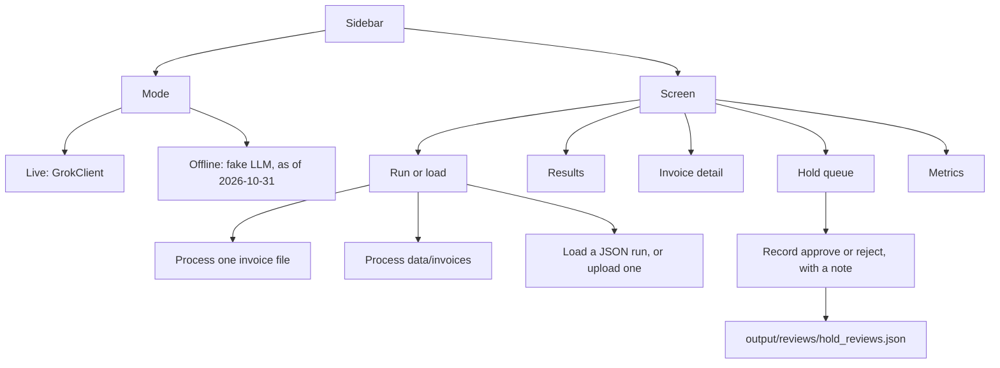

# Solution

This is the walkthrough for the invoice prototype: what it decides, where Grok is allowed to speak, and how a reviewer can run it. The audience is a Galatiq review of a forward-deployed-engineer take-home, and the live presentation of that work.

The pipeline reads one invoice, checks it in code, and either pays it or stops with a reason. A USD total over $10,000 gets one critique. The audit can send the extraction back at most three times. Payment runs only after a passing audit on an approve.

## The problem

The brief in the [README](README.md) is Acme Corp, a PE-backed manufacturer, losing $2M a year on manual invoice handling. Bills arrive by email as messy PDFs. Staff retype them, check a legacy inventory database, chase a VP over email, and pay through a banking API. The brief names a 30% error rate, five-day delays, and frustrated stakeholders.

A wrong approve pays a bad bill. A wrong reject or a vague hold sends the vendor, or a colleague, chasing the wrong fix. The prototype has to finish the path the brief asks for: ingestion, validation against a local inventory snapshot, approval with an extra look at large bills, and either a mock payment or a logged reason.

The labeled sets are small on purpose. [data/answer_key.json](data/answer_key.json) covers the 20 files in `data/invoices/` (7 approve, 9 reject, 4 hold). [data/extra_answer_key.json](data/extra_answer_key.json) covers the 21 files in `data/extra_invoices/` (8 approve, 7 reject, 6 hold). The second set is the unseen check. The human-readable copies are [docs/ANSWER_KEY.md](docs/ANSWER_KEY.md) and [docs/EXTRA_ANSWER_KEY.md](docs/EXTRA_ANSWER_KEY.md).

## The approach

Five rules keep the system predictable.

1. **Code decides.** Every problem a stage raises is a finding with a stable code. `outcome_from_findings` in `decision/outcome.py` is the one place that turns that list into approve, reject, or hold. The same findings always produce the same outcome.
2. **Grok extracts and flags.** The model reads the document, writes a short approval note, critiques a large bill, and returns an audit verdict. The outcome comes from the findings.
3. **Critique and audit can only tighten.** Either step may move an approve toward a hold. The [fact guard](#the-fact-guard) then sets aside a narrow set of claims that contradict facts the code already checked. The captain's wording of that rule is the ground-rule bullet in [docs/DECISION_POLICY.md](docs/DECISION_POLICY.md#ground-rules).
4. **One invoice, one graph.** `run_invoice` compiles a new graph per file. Nothing in `PipelineState` is kept for the next file.
5. **Payment is a signed-off exception.** The mock gateway runs only when a PASS audit has issued a one-time authorization for that vendor, amount, and currency.

The numbers live in [policy.toml](policy.toml). `decision/policy.py` loads that file at startup. A missing key, a wrong type, or a nonsense value stops the process and names the key.

| Knob | Value | What it does |
|---|---|---|
| `scrutiny_threshold` | 10000 | A USD total strictly over this goes to critique once. Being over it is not a risk by itself. |
| `critique_cap` | 1 | One critique pass, then approval again. |
| `audit_send_back_cap` | 3 | The audit may send the extraction back three times. The next send-back becomes a hold. |
| `allowed_currencies` | USD | Any other currency is a hold. Nothing is converted. |
| `money_tolerance` | 0.01 | Line math must match the printed total within one cent. |
| `model_retry_attempts` | 5 | Then the invoice is a `SYSTEM_ERROR` hold and is not paid. `XAI_MAX_ATTEMPTS` can override one run. |
| `price_spike_ratio` | 0.50 | `abs(unit_price)` at least 50% above the USD reference is a `PRICE_SPIKE` hold. |
| `reference_prices` | WidgetA 250, WidgetB 500, GadgetX 750 | USD references. A smaller gap stays a `PRICE_VARIANCE` warning. |

Reference prices live in that file. The inventory table stays the four README stock rows: WidgetA 15, WidgetB 10, GadgetX 5, FakeItem 0.

## Architecture

`graph.py` wires a LangGraph `StateGraph`. The stage bodies are ordinary functions under `pipeline/`. The generated picture of the same edges is [docs/graph.md](docs/graph.md) (`python3 scripts/export_graph.py` regenerates it). The six diagrams below are the ones to talk through.

### The pipeline

Holds and rejects both end at `reject_log`. Nothing on that path is paid. A hold is what a person works later, on the review screen's Hold queue. The graph records the hold and stops.



A few routing details are easy to miss on the picture.

- Validation that already has a reject or a hold goes straight to `reject_log`. Those invoices never reach approval, critique, or audit. A non-USD bill is in this group.
- Critique runs only when the currency is allowed (USD), the total is present, the total is strictly greater than 10000, and `critique_rounds` is still 0. A total of 10000.00 stays on the audit path.
- After a send-back, audit clears the decision and sets `critique_rounds` back to 0, so a later pass can critique again.
- `payment` runs when the outcome is approve. A PASS verdict on a reject means the audit is finished. That invoice still ends at `reject_log`.

### Who decides

Code decides. Grok extracts and flags. Critique and audit can only tighten. The fact guard runs after each of those two model calls.



The approval sentence is written in Python from the checks and the finding text. Grok supplies `risks_considered`. On the second visit, after critique, `critique_rounds` is 1, so the threshold check falls through to audit. A stricter critique is still audited, and audit keeps that hold.

### Decision precedence

Reject wins over hold. Hold wins over approve. Warnings stay on the record and do not decide the outcome by themselves. Two `FRAUD_SIGNAL` findings count as a hold even when a `FRAUD_CLUSTER` row was not stored yet.



The primary reason is the first matching code in the ordered list in `decision/outcome.py`. Approve has no reason code. These rows are the examples behind the diagram. Each one is the answer key's outcome for that file.

| Outcome | Reason code | Example |
|---|---|---|
| Reject | `STOCK_SHORTFALL` | `invoice_1002.txt` asks for 20 GadgetX against stock of 5. `invoice_1003.txt` is the same code, and its urgency and wire-transfer signals stay on the record. |
| Reject | `UNKNOWN_ITEM` | `invoice_1008.txt` names SuperGizmo and MegaSprocket. |
| Reject | `EMBEDDED_INSTRUCTIONS` | `invoice_2107.pdf` tells the system to ignore previous instructions. |
| Reject | `TOTAL_MISMATCH` | `invoice_2005.xml` leaves shipping out of the printed total. |
| Hold | `NON_USD` | `invoice_1014.xml` is in EUR. |
| Hold | `PRICE_SPIKE` | `invoice_2001.pdf` prices WidgetA at $800 against a $250 reference. |
| Hold | `FRAUD_CLUSTER` | `invoice_2112.txt` has urgency and a wire-only instruction. |
| Hold | `REVISED_INVOICE` | `invoice_1004_revised.json` is revision R1. |
| Approve | none | `invoice_1001.txt`. `invoice_1004.json` also approves, with a `NONCOMMERCIAL_ADDRESS` warning for 742 Evergreen Terrace. |

`invoice_2106.txt` is an approve in the extra key: $11,500, every line at the reference price, WidgetB quantity 8 against stock of 10. It is the bill the blind run got wrong. That story is in [How it was validated](#how-it-was-validated).

### The audit send-back

The cap is applied inside audit, before the graph routes. While `send_backs` is 0, 1, or 2, a `SEND_BACK` verdict returns to ingestion with the feedback, clears the decision, and resets the critique counter. When `send_backs` is already 3, that same verdict becomes an `ESCALATE` hold (`AUDIT_ESCALATED` when the rules had not already recorded a hold). The route then is `reject_log`.



A send-back that comes back as a reject or a hold at validation stops there. It does not re-enter audit. If the printed total cannot be found in the raw text, a model `PASS` is turned into a `SEND_BACK` before the cap is applied. An escalation or a send-back that cites only warning codes is dropped and recorded as an `AUDIT_NOTE`.

### The fact guard

Critique and audit each receive a `verified_by_code` object: today's date, summed quantity against available stock, whether the totals reconcile, the reference prices, and whether the invoice date and the due date are after today. The guard then looks at the category the model put on the claim.



Covered stock means the named item is in the snapshot and the summed quantity is less than or equal to the available units. An equal quantity is covered. A blank item name is kept. A plain string has category `other` and is kept. Audit does not drop a stock claim or a totals claim, because those notes may be about a disagreement with the raw text.

On an audit, a `SEND_BACK` or an `ESCALATE` becomes `PASS` only when the guard set at least one concern aside, nothing remains, and the audit cited no finding code. A send-back stands while any feedback remains. An escalation does too, and either stands when the audit cites a finding code. Every set-aside is written to `dropped_concerns` on that stage's log, with the rule that fired.

### How the review screen moves

The screen is a sidebar. Mode and Screen are two radios. Any screen can be opened once a run is in the session. The empty session tells you to process or load something on Run or load.



## What each step does

### Ingestion

`pipeline/ingestion.py` reads the file, then asks Grok for one JSON object. PDFs contribute their text layer. There is no network fetch. The prompt includes today's date, and, after a send-back, the field notes from audit.

Code normalizes item names (case, spaces, hyphens) and the invoice number. A parenthetical descriptor is split into a note. The model sets `embedded_instructions` and `noncommercial_address`. An unreadable file is a reject, reason `UNREADABLE`. A model failure after the retries is a hold, reason `SYSTEM_ERROR`.

The deterministic readers under `parsers/` are the offline stand-in and the test double. The live graph extracts with Grok.

### Validation

`pipeline/validation.py` is Python only. It loads the stock snapshot read-only and calls `assess` in `decision/findings.py`. That pass checks required fields (vendor, due date, line items, total), quantities, unknown items, summed stock, line math within 0.01, currency, revisions, credit notes, fraud wording, USD price spikes, and the phrase check for embedded instructions.

Embedded instructions reject only when the model flag is set and the text matches an imperative phrase aimed at the system. The bare word "approve" does not match. A non-commercial address is a warning. The deterministic address cue is an apartment marker. An O-to-0 reading is kept only when the math then reconciles, and it is recorded as `OCR_FIX`.

If the assessment is approve, the graph continues with the outcome cleared. A reject or a hold is stored and `reject_log` is next.

### Approval

`pipeline/approval.py` does not choose the outcome. The decision is already approve, or hold when critique has made it stricter. Grok returns `risks_considered`. Python fills `rules_applied`, the evidence lines, and the conclusion sentence. Critique concerns are appended to the note so the audit can see that they were addressed.

Wording that refuses the input, or that fights an approve decision, is retried as `bad_reasoning`. When the retries are finished, the reason code is `BAD_REASONING` and nothing is paid.

### Critique

`pipeline/critique.py` runs when the USD total is over 10000 and this pass has not been critiqued yet. A send-back resets that counter. The model returns concerns and a `stricter` flag. It may only make the decision stricter. A concern that says nothing beyond the dollar threshold is dropped before the fact guard. The guard then applies the three critique rules in [The fact guard](#the-fact-guard).

On a successful critique, the decision becomes a hold when the model sets `stricter`, the current decision is approve, and at least one concern remains. That adds a `CRITIQUE_HOLD` finding, approval records the hold, and audit keeps it. When the flag stays clear, approval stays an approve. Either result returns to approval, and the next route is audit.

### Audit

`pipeline/audit.py` asks Grok for `PASS`, `SEND_BACK`, or `ESCALATE`, plus feedback, notes, and `cited_codes`. Python will not loosen the result. The order inside `_guard_audit` is the one that matters in a review:

1. A blocking reject, or a decision that is already reject, stays a reject. The verdict is `PASS` so the graph does not send the bill back.
2. Hold findings on an approve become an `ESCALATE` hold.
3. Critique concerns that never appear in the approval note become an `ESCALATE` hold.
4. A `PASS` whose total is missing from the raw text becomes a `SEND_BACK`.
5. A `SEND_BACK` after three send-backs becomes an `ESCALATE` hold: "Audit send-back cap reached. Hold, no payment."
6. A decision that is already hold, or a model `ESCALATE`, stays a hold.
7. An approve with a `PASS` stays an approve and receives a one-time payment authorization.

The authorization key is the invoice path plus a SHA-256 of the raw text. Feedback that the fact guard removed is logged. Warning-only citations become an `AUDIT_NOTE` and do not escalate.

### Payment

`pipeline/payment.py` calls `mock_payment` only with an unused authorization whose vendor, amount, and currency match the invoice. For a decimal amount the mock prints `Paid {amount:.2f} to {vendor}` and returns `{"status": "success"}`. The key is stored in an in-memory set before the call, so a second use of that key in the same process is refused.

Any other case is `not_paid`. A refused authorization adds `PAYMENT_REFUSED`. That code does not change the invoice outcome. A currency outside `allowed_currencies` is blocked here as well.

### Reject log

`pipeline/reject_log.py` is the other exit. Rejects are logged as stage `reject_log`. Holds are logged as stage `hold`. The graph node is the same. The record includes the outcome, the primary reason code, the next action, and a `not_paid` payment row. A reject names what the vendor must resend. A hold names what a person has to do.

## Decision policy

The captain-approved policy is [docs/DECISION_POLICY.md](docs/DECISION_POLICY.md). The finding tables, the vendor's next step on each reject, and the person's action on each hold live there. This section is the shape of those rules.

- **Precedence is reject, then hold, then approve.** A reject wins when a hold or a fraud signal is also present. Those other findings stay in the reason.
- **The model reads and flags. Code decides.** The same findings always give the same outcome.
- **Each invoice is judged on its own.** Processing order never changes a result.
- **An OCR number fix is kept only when the math reconciles.**
- **Duplicates are out of scope.** The production check is a payments ledger. See [Known limitations](#known-limitations).
- **No payment without an audit PASS.**
- **Non-USD is never paid.** Nothing is converted, and reference prices are not compared.
- **Critique and audit can only tighten.** The [fact guard](#the-fact-guard) may set a claim aside before that tightening is allowed to stand. On a critique, the claims that can be set aside are a stock claim whose summed quantity is covered by available stock, a totals-mismatch claim when the totals already reconcile, and a future-date claim on the invoice date or the due date when that date is not after today. On an audit, the same future-date claim can be set aside. Every other concern is kept, including a note that the raw text and the extraction disagree. A send-back stays a send-back while any feedback remains. An escalation stays on the same terms, and either one stays when the audit cites a finding code. In code, that verdict becomes `PASS` only after the guard has set at least one concern aside, nothing is left, and no finding code was cited. Every set-aside is logged. The captain's sentence is the ground-rule bullet in [docs/DECISION_POLICY.md](docs/DECISION_POLICY.md#ground-rules).

[Known follow-ups](docs/DECISION_POLICY.md#known-follow-ups) still records two earlier gaps: April 2026 dates treated as future dates, and a critique hold on a clean invoice whose total is over $10,000. In this tree, extraction, approval, critique, and audit each receive today's date. A critique concern that names nothing beyond the dollar threshold is ignored. The tighten rule above is what the code applies.

## How it was validated

The live model is Grok through the xAI API. `GrokClient` uses the OpenAI SDK at `https://api.x.ai/v1`, model `XAI_MODEL`, default `grok-4.20-0309-non-reasoning`, temperature 0. Those live runs were recorded earlier. They were not repeated for this write-up.

`scripts/eval.py` scores outcome and primary reason code. Warning matches are printed and do not change the exit code. The process exits 0 when every file matches and the file count equals the key. The sample key lists 19 warnings in total. The extra key lists 9.

**Before the fix.** On main `a9c09649`, three live runs of the unseen 21 scored 20/21 every time. The 20 samples scored 20/20 in the same session. The miss was stable across all three runs: `invoice_2106.txt`. The key says approve. The run said hold, reason `CRITIQUE_HOLD`.

The bill is $11,500. WidgetA 15 at $250, WidgetB 8 at $500, and GadgetX 5 at $750 are the reference prices, and the lines add up. Extraction was correct. WidgetB's 8 is within the 10 in stock, and a quantity equal to stock would have passed too. The over-$10,000 critique invented a stock concern: "WidgetB requested 8 vs available 10". The audit also called the invoice date 2026-04-16 and the due date 2026-05-16 future dates.

**The fix.** Pull request 14 gives critique and audit the code-verified facts, and adds the narrow fact guard above. Each set-aside is logged. Prompts were not tuned to chase the score. The guard's head is `e068908e`, merged as `2869b95`. The ground-rule sentence for that guard landed in pull request 15, merged as `7f3295b`.

**After the fix.** At `e068908e`, the samples scored 20/20 on all three runs, with warnings 19/19. The unseen set scored 21/21 on all three runs, with warnings 9/9. Across those six runs the guard set aside six concerns. All six came from 2106's critique, and all six were fabricated future-date claims. Nothing was set aside on a sample invoice, and nothing was set aside by an audit.

**Tests.** `python3 -m pytest` passed 129 tests.

## The review screen

The Streamlit app in [ui/app.py](ui/app.py) is the review screen. The launch line in that file is `streamlit run ui/app.py`. The title is "Invoice review". The sidebar has two controls.

**Mode** is `Live (Grok)` or `Offline (fake LLM)`. Live is the default when `XAI_API_KEY` is set. Live runs `GrokClient`, the same client `main.py` constructs. Offline uses the fake LLM from the tests: extraction comes from the deterministic parser, the clock and the jitter are fakes, and the date the agents are told is 2026-10-31.

**Screen** is one of five:

- **Run or load.** One invoice path, default `data/invoices/invoice_1001.txt`, with "Process this invoice" and "Process data/invoices". A caption says payment will not run twice for the same invoice in this session. The other column loads a run file (the placeholder is `output/runs/review_run.json`) or an uploaded JSON file. "Save run file" writes `output/runs/review_run.json`. The page shows the session tally of approve, reject, and hold.
- **Results.** A filter for all, approve, reject, or hold, then a table of invoice, outcome, reason code, amount, and reason.
- **Invoice detail.** Outcome, reason code, total, payment status, the reason, the next action, and the payment detail. Then the extracted header, the line items as a table, the findings, and the agent trail. Raw text sits in an expander. The selector opens on the paid invoice with the most warnings, when any paid invoice has one.
- **Hold queue.** Only invoices whose outcome is hold. Each row shows the reason code, the amount, the payment status, and the next action. A reviewer records approve or reject and a note. The note is required. The file is `output/reviews/hold_reviews.json`. The caption on the screen says the review is a local note: it does not call payment, and it does not change the pipeline outcome.
- **Metrics.** Counts for the three outcomes, USD totals for each, and the average time per invoice when the run has timings. Amounts in any other currency are listed underneath and are left out of the USD totals. Nothing is converted.

Until a run is in the session, the other four screens say to process an invoice or load a run file.

## How to run it

From the [README](README.md):

```bash
python3 -m venv .venv
.venv/bin/pip install -r requirements.txt
cp .env.example .env
# set XAI_API_KEY in .env
python3 setup_db.py
python3 main.py --invoice_path=data/invoices/invoice_1001.txt
python3 scripts/eval.py
```

`.env.example` names `XAI_API_KEY`, `XAI_MODEL` (`grok-4.20-0309-non-reasoning`), and `XAI_MAX_ATTEMPTS` (5). A missing `XAI_API_KEY` exits 1 before any invoice is processed. `main.py` creates `inventory.db` only when the file is missing. The workflow then opens it read-only. One invoice prints a JSON object per stage and writes the same records to `logs/<filename>.json`.

The default eval scores `data/invoices/` against `data/answer_key.json`. The extra set uses the two flags the script already accepts:

```bash
python3 scripts/eval.py --invoices data/extra_invoices --answer-key data/extra_answer_key.json
```

The review screen, from the module docstring:

```bash
streamlit run ui/app.py
```

## Known limitations

**Duplicates, and the payments ledger.** Each file is a new graph. Payment remembers authorization keys only inside the current process. The key is the file path plus a hash of the text, so a second copy at a different path can still be approved and paid. A repeated key in the same process is refused (`payment refused: authorization key was already used`) and the invoice outcome stays what the audit decided. A revised invoice is a hold on that file alone. Nothing looks up another file to see whether the original was paid. The production check is a persistent payments ledger before paying. That is the same limit called out in the [README](README.md), in [docs/DECISIONS.md](docs/DECISIONS.md), and in the policy's ground rules.

**The model labels its own concern categories.** The fact guard trusts the `category` field on the claim. A stock claim and a totals-mismatch claim are examined only on critique, and only when the model used those categories. A future-date claim is examined only when `field` is `invoice_date` or `due_date`. A plain string becomes category `other` and is kept. So is every other category, including an audit note that the raw text and the extraction disagree. A fabricated stock sentence labeled `other` would survive the guard.

**Non-USD invoices are never paid.** `allowed_currencies` is USD. Any other currency is a `NON_USD` hold at validation, so the graph stops at `reject_log`. Nothing is converted. Reference prices are not compared. Payment also refuses a currency outside the allowed list if one ever reached it.

**Inventory is read-only.** `setup_db.py` is the writer, and `main.py` calls the same creator only when `inventory.db` is missing. The workflow opens `file:inventory.db?mode=ro`. The table is the four README rows and has no price columns. Approving an invoice does not decrease stock. Quantities are summed per item. A quantity equal to stock passes. A quantity over stock is `STOCK_SHORTFALL`.

## Next steps

- Check a persistent payments ledger before paying, and treat a second file of the same bill as a duplicate. Use that same memory when a revision asks whether the original was paid.
- Assign concern categories in code, so a mislabeled sentence can still be set aside. The guard today believes the label the model sends.
- Keep non-USD invoices unpaid until finance confirms the currency and the amount. The prototype has no conversion.
- Read stock from the system of record at decision time. Keep the decision in code. This prototype's snapshot stays the four seed rows, opened read-only, and it does not move when a bill is approved.
- Give the hold queue a durable home. The screen can already record a person's approve or reject. That note still does not pay, and the pipeline outcome stays a hold until a real authorization exists.
