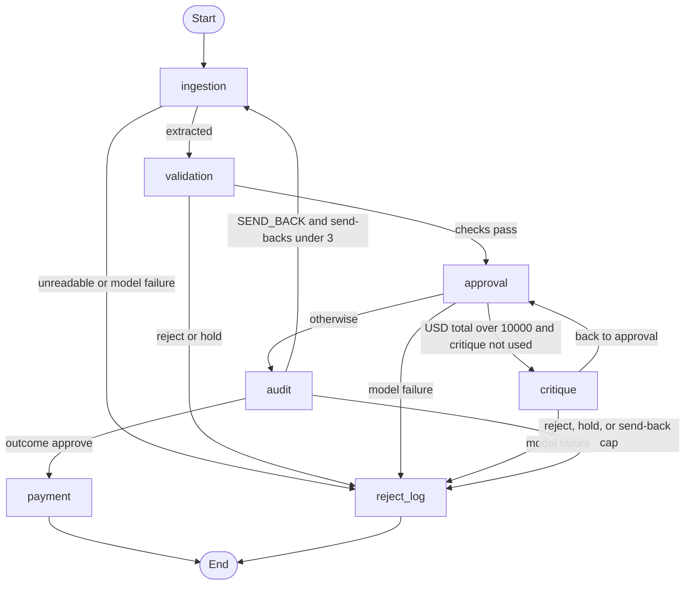

# Demo

A walkthrough for a 10 to 15 minute slot. Commands are from the repo root after the install in the [README](../README.md) quick start. Replay needs no API key. A live command needs `XAI_API_KEY`. The outcomes below are from the replays on 2026-11-01 PT, the same runs as [METRICS.md](METRICS.md).

## 1. Architecture

Code decides. The model extracts fields and writes notes. Critique and audit can only tighten. Payment runs only after an audit PASS on an approve.



That is the routing in `graph.py`. Holds and rejects both end at `reject_log`. Nothing on that path is paid. A USD total of 10000 stays on the audit path. The threshold in `policy.toml` is 10000, and the route is strictly greater than that.

## 2. One invoice

`data/invoices/invoice_1001.txt` is Widgets Inc., INV-1001. WidgetA quantity 10 at 250.00 and WidgetB quantity 5 at 500.00. The printed total is 5000.00. `setup_db.py` loads WidgetA 15, WidgetB 10, GadgetX 5, and FakeItem 0.

```bash
python3 setup_db.py
XAI_TOOLS=0 python3 main.py --invoice_path=data/invoices/invoice_1001.txt --reset-ledger --replay recordings/samples.jsonl
```

The replay on 2026-11-01 PT printed one JSON object per stage, in this order: ingestion, validation, approval, audit, payment. Then the mock line `Paid 5000.00 to Widgets Inc.` The result line was outcome `approve`, `payment_status` `paid`, and no tool calls. The same records are written to `logs/invoice_1001.txt.json`.

What to say while it scrolls:

- Ingestion is the model, replayed from the file. Validation is Python. Stock covers both lines, the total matches, and the currency is USD, so there is no finding that decides the outcome.
- The total is 5000, under 10000, so critique does not run. Approval asks the model for `risks_considered`. Python writes the rules, the evidence, and the conclusion.
- Audit returns PASS. Payment runs because that PASS issued a one-time authorization for this vendor, amount, and currency. `--reset-ledger` deletes `payments.db` first so a second demo of this file is not a duplicate hold.

## 3. Review screen

```bash
streamlit run ui/app.py
```

The title is "Invoice review". The sidebar has Mode and Screen.

Mode is `Live (Grok)` or `Offline (fake LLM)`. Live is selected when `XAI_API_KEY` is set. Otherwise the radio starts on Offline. Live uses `GrokClient`, the same client as `main.py`. Offline uses the fake LLM from the tests: extraction comes from the deterministic parser, and the date the agents are told is 2026-10-31. Offline is not the recording. Replay is the `--replay` command above.

Screen is one of five. Until a run is in the session, the other four say to process an invoice or load a run file on Run or load.

- **Run or load.** One invoice path, default `data/invoices/invoice_1001.txt`, with "Process this invoice" and "Process data/invoices". The caption says payment will not run twice for the same invoice in this session. That is the in-memory authorization key. This screen does not pass `payments.db`. Each call gets a fresh temporary ledger. The other column loads a run file or an uploaded JSON file. "Save run file" writes `output/runs/review_run.json`.
- **Results.** A filter for all, approve, reject, or hold, then a table of invoice, outcome, reason code, amount, and reason.
- **Invoice detail.** Outcome, reason code, total, and payment. Then the reason, the next action, and the payment detail. Then the extracted header, the line items, the findings, the agent trail, and the tool calls. Raw text sits in an expander. The selector opens on the paid invoice with the most warnings, when any paid invoice has one.
- **Hold queue.** Only holds. Each row shows the reason code, the amount, the payment status, and the next action. A reviewer records approve or reject. The note is required. The file is `output/reviews/hold_reviews.json`. The caption says the review is a local note: it does not call payment, and it does not change the pipeline outcome.
- **Metrics.** Counts for the three outcomes, and USD totals for each. The average-time box reads `n/a` when the run has no timings, and a seconds value when it does. Amounts in any other currency are listed underneath and are left out of the USD totals. Nothing is converted.

To show the replay without a key, load the log just written. On Run or load, set the run file to `logs/invoice_1001.txt.json` and click "Load run file". A pipeline log is read as a Grok run. Then open Invoice detail.

## 4. A duplicate the ordered scenario catches

Scored eval gives each invoice a fresh ledger, so the sample key never sees a duplicate. Order is a separate file.

```bash
XAI_TOOLS=0 python3 scripts/eval.py --ordered --replay recordings/ordered.jsonl
```

From the replay on 2026-11-01 PT, the first two lines:

- `invoice_1001.txt` outcome approve, paid, ok
- `invoice_1001.txt` outcome hold, reason `DUPLICATE_INVOICE`, not paid, ok

Same file, same vendor and invoice number, second time. Validation holds it. Audit and payment do not run. The tool count on both lines is 0.

The next pair is the other-format case: `invoice_1011.pdf` approves and is paid, then `invoice_1011.txt` is a `DUPLICATE_INVOICE` hold and is not paid. Then `invoice_1004.json` is paid, and `invoice_1004_revised.json` is a `DUPLICATE_INVOICE` hold. That step was ok, and the scenario requires `REVISED_INVOICE` to remain on the finding list. The run ends with 3 ledger rows: `invoice_1001.txt`, `invoice_1011.pdf`, `invoice_1004.json`. Exit 0. `tools calls=0 repeats=0`. `tokens total=17358 cost_usd=0.026695`.

## 5. Tool calls in the audit log

The audit tools (XAI_TOOLS) are the only tools. Critique is not given them. They are read-only, bound to the current invoice, and they do not decide and do not pay. A hit can only add a hold.

```bash
python3 main.py --invoice_path=data/invoices/invoice_1001.txt --reset-ledger --replay recordings/samples_tools.jsonl
```

The replay on 2026-11-01 PT was again approve and paid. The result line listed 6 tool calls, in this order: `check_payment_ledger`, `lookup_item`, `lookup_item`, `recompute_totals`, `get_policy_rule`, `get_policy_rule`. There was no `tool_cap_hit` and no `forced_final_turn`.

Load `logs/invoice_1001.txt.json` in the review screen and open Invoice detail, Tool calls. Each row shows the stage or agent, the round, the attempt, the name, the arguments, the result or the error, and the latency when the log has one. A repeat is marked and noted as a reused result that does not count toward the cap. A call whose error is `blocked: tool_cap` is marked blocked. This 1001 log has neither.

`check_payment_ledger` takes no arguments. On a fresh ledger it reports that this vendor and invoice number were not paid. The lookup is there for two workers, or for a payment made outside this run, between validation and audit. It can only tighten.

The samples-with-tools replay called the ledger tool 7 times and repeated one `get_policy_rule`, on `invoice_1004.json`. The full table is in [METRICS.md](METRICS.md).

## 6. Replay when the API or the network fails

Use the same code path with `--replay` and no key. Do not pass `--record` and `--replay` together.

```bash
python3 setup_db.py
python3 scripts/eval.py --replay recordings/samples_tools.jsonl
python3 scripts/eval.py --invoices data/extra_invoices --answer-key data/extra_answer_key.json --replay recordings/unseen_tools.jsonl
python3 scripts/eval.py --ordered --replay recordings/ordered_tools.jsonl
XAI_TOOLS=0 python3 scripts/eval.py --replay recordings/samples.jsonl
XAI_TOOLS=0 python3 scripts/eval.py --invoices data/extra_invoices --answer-key data/extra_answer_key.json --replay recordings/unseen.jsonl
XAI_TOOLS=0 python3 scripts/eval.py --ordered --replay recordings/ordered.jsonl
```

Audit tools are on by default, so the `_tools` files match a run with `XAI_TOOLS` unset. `samples.jsonl`, `unseen.jsonl`, and `ordered.jsonl` match `XAI_TOOLS=0`. A mismatch changes the audit prompt, the fingerprint misses, and the invoice is a `SYSTEM_ERROR` hold. Nothing is paid. A miss is not a live call.

CI runs those six after the tests and does not set an API key. The scores from the 2026-11-01 PT replays are in [METRICS.md](METRICS.md).

## 7. Releasing a held invoice

A reviewer can pay a hold without the review screen. The command runs the offline pipeline on two real files, then calls `approve_and_pay`. The ledger and the decision log are temporary. It does not call the model.

```bash
python3 scripts/approve_hold_demo.py --demo
```

`invoice_1012.txt` is a `VENDOR_RENAMED` hold. The mock line is `Paid 9975.00 to QuickShip Distributers (formerly FastShip Ltd.)`. The decision record says `paid` and `pipeline_outcome` stays `hold`. `invoice_1002.txt` is a stock shortfall. It stays unpaid, `decision` `held`, reason `NOT_PAYABLE`, and `pipeline_outcome` stays `reject`. The review screen does not call `approve_and_pay` yet.
