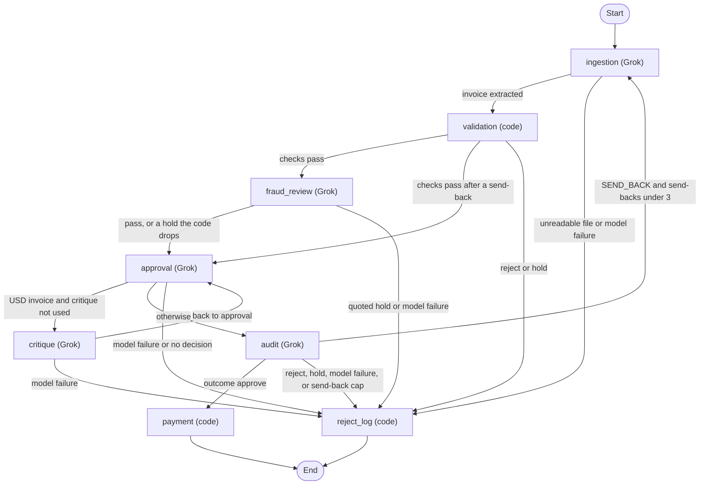

# Decision policy

Every invoice ends in one outcome: approve, reject, or hold. Every outcome carries a reason code and a plain-English reason. What each agent does, and how it fails, is in [Extended details](#extended-details).

The numbers live in [policy.toml](../policy.toml). `decision/policy.py` loads that file at startup. A missing key, a wrong type, or a nonsense value stops the process and names the key.

How each of Acme's manual steps is replaced, and who owns each kind of hold, is in the [README](../README.md#what-changes-for-acme).

## Agents

`graph.py` wires a LangGraph `StateGraph`. Each agent is a node. Ingestion, fraud review, approval, critique, and audit call Grok. Validation, payment, and `reject_log` are code. Fraud review runs once per invoice, after validation passes and before approval. Critique returns to approval. Audit can send the extraction back to ingestion. Holds and rejects both end at `reject_log`. Nothing on that path is paid. Payment runs only on an approve that passes all six [pass-list](#the-pass-list) checks, one of which is an audit PASS.

## Key decisions

### Why code decides

Grok does the reading and the judging: it extracts the fields, reads each invoice for payment fraud, lists the risks, critiques every USD bill, and audits with tools. Code turns those findings into approve, reject, or hold. Paying money needs the same invoice to get the same answer every time, and every answer has to be traceable to a rule. So a model can make a decision stricter but never looser, and text inside an invoice cannot talk the system into paying it. A fraud-review hold stands only when code finds its quote on the page. The trade-off is less model autonomy. In return, no reject or hold that code or a quoted model hold could see was paid in any labeled run of the final code. Before critique ran on every invoice, judgment invoice 2146 was paid: it is under $10,000, and audit read past it ([Limitations](#limitations)).

### Rules

- Code decides: reject wins over hold, hold wins over approve, and critique and audit can only tighten.
- Audit has tools that read inventory, totals, policy, and the ledger, cap at 3 rounds and 8 calls, and cannot pay.
- The same vendor and invoice number is a `DUPLICATE_INVOICE` hold, and a same-vendor cluster of invoices each at or under the threshold, inside the split window, that crosses it together is a `SPLIT_INVOICE` hold.
- Scored eval uses a fresh ledger per invoice, and `scripts/eval.py --ordered` shares one ledger.
- Replay runs this code on saved replies with no API key and no network, and a miss is a `SYSTEM_ERROR` hold that pays nothing.
- A non-USD invoice is a hold, and nothing is converted.
- Invoice 1003 is a stock reject, and its fraud signals stay on the record.
- Invoice 1004 passes validation, and code records its non-commercial address as a warning. Fraud review holds it as `FRAUD_SUSPECTED`, which is its label; an approve is also accepted.
- Fraud review can only add a hold, and the hold stands only when its quote is on the page. A failed fraud call is a `SYSTEM_ERROR` hold.

## Extended details

How each agent does its job, and how it fails.

Grok is `XAI_MODEL`, default `grok-4.20-0309-non-reasoning`, called through the OpenAI SDK at `https://api.x.ai/v1`. Fraud review and critique use `grok-4.20-0309-reasoning`. Temperature is 0.

### Ingestion

Grok extracts one JSON object from the file text. PDFs contribute their text layer. There is no network fetch. Code normalizes item names and the invoice number, and it copies each item name as printed.

Before any Grok call, code checks that the file can be read. An empty or blank file, JSON that does not parse or is not an object, XML that does not parse, and a CSV with a header but no rows are each a reject, `UNREADABLE`, and the reason names the problem (for cut-off JSON or XML, the line and column). Grok is never sent an empty page, so it cannot invent an invoice from one. A file that passes is still extracted by Grok; the plain JSON, CSV, and XML parsers are the fallback and the test double. A model failure after the retries is a hold, `SYSTEM_ERROR`. Nothing is paid.

### Validation

Validation is Python. It checks required fields, quantities, unknown items, summed stock, line math within one cent, currency, revisions, credit notes, fraud wording, USD price spikes, and each item name against the source text.

A reject or a hold stops here and never reaches approval, critique, or audit. A ledger it cannot read is a `SYSTEM_ERROR` hold. A missing or empty source text is an `ITEM_NOT_IN_SOURCE` hold. An unknown item stays a reject. The reason adds "Likely meant X." only when exactly one inventory name is one letter away, and the item is never substituted.

### Fraud review

Fraud review runs once per invoice, on an invoice that validation passed, before approval. A send-back does not run it again. It makes one call to `grok-4.20-0309-reasoning`, which has the same published rates as the default model; reasoning tokens are billed as output. Across the seven recordings a review averaged $0.0033–$0.0046.

The model sees the raw page text, the extracted vendor, address, invoice number, total, currency, payment terms, and notes, and the code's findings. The findings are context only. The model may hold an invoice with none and pass one with some, and every finding stays on the record as it was. It judges four kinds of red flag by meaning, not by keyword:

- **Redirected payment.** The money would go to someone other than the vendor, or to a payee, account, or method that differs from the vendor's established one, or AP is asked to change its payment records.
- **Discouraged verification.** The page steers AP away from confirming through contacts it already holds.
- **Impersonated or unverifiable vendor.** The payee, sender, or contact does not match the vendor, or the vendor cannot be checked: a free email address for business matters, a mailbox-only address, or names that disagree across the page.
- **Pressure to bypass checks.** Unexplained urgency, secrecy, or a request to skip a purchase order, an approval, or review.

The red flags come from these sources. No phrase from a test invoice is in the prompt, and a test checks every four-word phrase of every invoice in `data/` against it.

- FBI Sacramento, [business email compromise red flags](https://www.fbi.gov/contact-us/field-offices/sacramento/news/press-releases/sacramento-fbi-encourages-business-community-to-guard-against-and-report-business-email-compromise), and IC3 [PSA230609](https://www.ic3.gov/PSA/2023/PSA230609): changed payment instructions, spoofed or look-alike senders, urgency, and verifying through a known contact.
- ACFE [fraud risk tests for billing schemes](https://legacy.acfe.com/fraudrisktools-tests.aspx), ACFE on [shell companies](https://www.acfe.com/fraud-resources/shell-companies), and the Journal of Accountancy, [Billing Schemes, Part 1](https://www.journalofaccountancy.com/issues/2002/jul/billingschemespart1shellcompaniesthatdontdeliver/): mailbox addresses, vendors that cannot be verified, and invoices without a purchase order.
- AFP, [2025 Payments Fraud and Control Survey](https://7185359.fs1.hubspotusercontent-na1.net/hubfs/7185359/Research%20Surveys/SURVEYS/2025%20Payments%20Fraud%20and%20Control%20Survey%20Report%20Comprehensive.pdf): vendor impersonation at 60%, and accounts payable as the most vulnerable function at 56%.

The reply is `verdict` (hold or pass), `innocent_reading`, `quote`, and `why`. Code decides what a hold means. It stands only when `innocent_reading` is not empty and the quote, after whitespace and case are normalized, is at least `fraud_quote_min_chars` long and appears in the raw text. A standing hold is `FRAUD_SUSPECTED`, a hold a reviewer can release. Any other hold is dropped and logged as `fraud_note` on the stage record; it is not a finding. A pass changes nothing.

Retries used up, a reply that still fails the schema after the repair turn, or a replay miss is a `SYSTEM_ERROR` hold. Approval and audit do not run, and nothing is paid. An API outage therefore holds every invoice that passed validation, the same as an ingestion or audit failure.

### Approval

Approval does not choose the outcome. The decision is already approve, or hold when critique has made it stricter. Grok returns `risks_considered`. Python writes the rules, the evidence, and the conclusion.

A model failure, or no decision, goes to `reject_log` and is not paid. Wording that refuses the input or contradicts an approve, after the retries, is a `BAD_REASONING` hold and is not paid.

### Critique

Critique runs when the currency is USD and this pass has not been critiqued, whatever the total. A total over $10,000 is logged as `vp_scrutiny: true` on the critique row and shown as VP scrutiny in the review screen's trail; the explanation's rules say such a total is marked VP scrutiny, and its conclusion says the total is over the review threshold. It is a label, not a risk. A non-USD invoice is already a hold and skips critique. A send-back resets that counter. The model sees the decision, the facts code checked, and the raw page, and is told to raise anything the extraction missed or misread, and to compare what is billed with what the page says was ordered, delivered, priced, or returned. Shipping, receiving, packing, and dock or delivery-scheduling notes are routine logistics and never a reason to hold; a delivery hold needs the page to say outright that fewer units were delivered than billed, that billed units were returned or cancelled, or that the stated price basis does not apply. That line was added after the first live runs held clean bills on "The receiver is out on Thursdays." and "Dock appointment is flexible." It returns concerns, each with a quote, a stricter flag, and an innocent reading. It can only turn an approve into a hold. It calls `grok-4.20-0309-reasoning`, with a 120-second timeout: on the default model it held the benign judgment twin 2141 in five runs of five, and on the reasoning model in none. A critique call cost $0.0078–$0.0080 on average across the three final live runs of all seven sets, $0.22–$0.23 per pass over the 82 files. That is about $0.16–$0.18, or 23–26%, more than when critique ran only over $10,000.

A model failure goes to `reject_log`. A concern that only restates the dollar threshold is dropped. The fact guard can set aside a covered-stock claim, a totals claim when the math already reconciles, or a future-date claim when that date is not after today. Every concern left must then pass the quote gate ([Tools, the ledger, and the fact guard](#tools-the-ledger-and-the-fact-guard)). A `CRITIQUE_HOLD` message quotes the page.

### Audit

Grok returns PASS, SEND_BACK, or ESCALATE. Python will not loosen the result. A PASS on a reject still ends at `reject_log`. While send-backs are under 3, a SEND_BACK returns to ingestion. The fourth send-back is an `AUDIT_ESCALATED` hold.

Tools are capped at 3 rounds and 8 calls. A cap hit gets one final reply with no tools. If that reply fails, or any tool fails, the invoice is a `SYSTEM_ERROR` hold and nothing is paid. A replay miss is the same hold, and it does not call the network.

### Payment

Payment runs only with an unused authorization whose vendor, amount, and currency match the invoice. The mock prints `Paid {amount:.2f} to {vendor}` and returns success. Any other case is `not_paid`. A refused authorization adds `PAYMENT_REFUSED` and does not change the outcome. The unique index on vendor and invoice number blocks a second payment.

### Reject log

Reject log is the other exit. Rejects are logged as stage `reject_log`. Holds are logged as stage `hold`. The graph node is the same. The record includes the outcome, the reason code, the next action, and a `not_paid` payment row. A reject names what the vendor must resend. A hold names what a person does.

Reject log also writes a release record. A reviewer can pay a hold from that record only when every finding is a releasable hold or a warning. The rules are in [Releasing a hold](#releasing-a-hold).

### Tools, the ledger, and the fact guard

Audit is the only stage with tools. Critique is not given them.

The four tools are `lookup_item`, `recompute_totals`, `get_policy_rule`, and `check_payment_ledger`. They are read-only and bound to the current invoice. They do not open the database, and they do not pay. A hit on the ledger tool can add a `DUPLICATE_INVOICE` or `SPLIT_INVOICE` finding. A miss adds nothing. An identical repeat returns the earlier result, does not run the tool again, and does not count against the 8-call cap. The round still counts.

`check_payment_ledger` takes no arguments. It reports prior payments for this vendor and invoice number, plus that vendor's paid total inside the split window. Two workers, or a payment made outside this run, can write the ledger after validation and before audit. The tool reads that payment. In one process, validation already holds a duplicate or a split, so those invoices never reach the tool.

`payments.db` sits next to `inventory.db`. Only the payment step writes it.

- **Match key.** The vendor name, casefolded with whitespace collapsed, plus the normalized invoice number. `INV 1004` and `INV-1004` are the same number. The same raw text is the same match.
- **Revisions.** A revision of an unpaid number is `REVISED_INVOICE`. After the original is paid, a revision with a higher total is still `REVISED_INVOICE`, and a reviewer can pay only the difference, stored as a supplement row. The same document, a revision that is not higher, or a different total not marked as a revision is `DUPLICATE_INVOICE`.
- **Splits.** The window is 30 days. An invoice's own number, including a supplement on it, is not part of its window, so a higher revision is not a split of the original. A paid invoice over the threshold is not part of any window: it already went through critique on its own, and counting it held every smaller bill from that vendor for 30 days. No sample file is a split.
- **Example.** A name-order pass of `data/invoices` on one ledger holds `invoice_1011.txt` as a duplicate after `invoice_1011.pdf` is paid. If `invoice_1004.json` is paid, `invoice_1004_revised.json` is held with the difference payable.
- **Payment states.** The row is reserved as `pending` inside the write lock, before the mock payment, so two writers cannot both pay. It becomes `paid` when the gateway confirms. If the gateway raises or does not confirm, the row becomes `failed` and the invoice is a `SYSTEM_ERROR` hold. A pending or failed row still blocks a second payment and is not a payable difference, because a failed call may have reached the bank. A person checks with the bank and clears it.

`python3 main.py --reset-ledger` deletes `payments.db` before that one file.

Critique and audit receive the facts the code already checked: today's date, stock, whether the totals reconcile, the reference prices, and whether the dates are after today. On a critique, the guard sets aside a stock claim whose summed quantity is covered, a totals-mismatch claim when the totals already reconcile, and a future-date claim on the invoice date or the due date when that date is not after today. On an audit, the same future-date claim can be set aside. A send-back stands while any feedback remains. Every set-aside is logged.

The quote gate then applies the fraud-review rule to critique concerns and to an audit escalation that cites no finding code. A claim code confirms (a requested quantity over stock, totals that do not reconcile, a date after today) stands without a quote. Any other claim stands only when all of these hold, and otherwise is set aside under the named rule:

- The draft gives an innocent reading (`no_innocent_reading`).
- The quote is at least `fraud_quote_min_chars` long after normalizing (`quote_too_short`) and appears in the raw text (`quote_not_on_page`).
- The quote touches wording, not only lines code has already checked: invoice number, date, due date, item lines, subtotal, and total (`quote_structured_only`). Notes, terms, memo, and remarks lines are wording; a tax or shipping line is too, because code checks its arithmetic but not whether it is reasonable. On a page that is not `.txt`, the quote must overlap the extracted notes or payment terms.
- The concern says something beyond its quote (`concern_restates_quote`).

An audit may cite a finding code instead of quoting, but a cited code counts only when code found it on this invoice, from validation, a fresh assessment, or a ledger-tool hit. Any other citation is set aside as `cited_code_not_found`. An escalation with no code left and no quote that passes the gate becomes a PASS. A standing audit escalation's `AUDIT_ESCALATED` message quotes the page.

`invoice_2106.txt` is a clean $11,500 approve. The guard exists so a critique cannot hold that bill on a stock or date claim the code has already checked, and the quote gate so it cannot hold it by quoting `Date: 2026-04-16`. `data/judgment_invoices/` is the other side: bills code approves whose own notes say not to pay them as printed ([answer key](JUDGMENT_ANSWER_KEY.md)).

The reject, hold, and warning tables follow.

## Approve

Approve when all checks pass and there are no blocking findings.

Every USD invoice gets one critique. That review can only make the decision stricter. A total over $10,000 is marked VP scrutiny; being over the threshold is not a risk finding by itself.

### The pass list

`decision/pass_list.py` names six checks. Payment refuses an approve unless all six are true, so a gap in the findings cannot pay an invoice on its own:

| Check | True when |
|---|---|
| Known vendor | The vendor is on the vendor master and there is no `NEW_VENDOR` finding. |
| Bank details unchanged | There is no `NEW_REMITTANCE` finding. |
| Printed total matches | The total is present, and there is no `PRINTED_TOTAL_MISMATCH`, `TOTAL_MISMATCH`, `AMOUNT_WORDS_MISMATCH`, or `BALANCE_DUE` finding. |
| No embedded instructions | There is no `EMBEDDED_INSTRUCTIONS` or `INJECTION_SUSPECTED` finding. |
| Total above zero, in USD | The total is greater than zero and the currency is allowed. |
| Audit passed | The audit verdict is PASS. |

The findings still decide the outcome. The pass list is the same facts read as an allow-list, and the last guard before payment. Every payment, hold, and reject record carries the six results, and the review screen shows them first in the trail. A reviewer's release uses the release rules below, not the pass list.

### The vendor master

`data/vendor_master.json` lists every vendor in the labeled sets except 2131's, which tests the unknown-vendor hold. It stands in for Acme's vendor master and holds names only, with no bank details. Names are compared after casefolding, turning `&` into "and", dropping punctuation, and dropping a trailing Inc., Ltd., LLC, Co., or Corp., so small differences in how Grok reads a name do not hold an invoice. A missing file fails closed: every vendor is unknown. `VENDOR_MASTER` points at another file.

## Reject

Reject means the vendor must send something new. Every reject names that next step.

| Finding | Next step for the vendor |
|---|---|
| Missing required field (vendor, due date, line items, total) | Resend the invoice with the missing field filled in. |
| Quantity that is zero, negative, or not a number | Resend with corrected quantities. |
| Unknown item | Resend with the correct item name. Code adds "Likely meant X." only when exactly one inventory name is one letter away, after case, spaces, and hyphens are removed. The item is still rejected and is never substituted. |
| Stock shortfall | Resend for the quantity in stock, or amend the PO. |
| Total or line-math mismatch | Resend with corrected totals. |
| Unreadable file | Resend in a readable format. |
| Embedded instructions aimed at the system | Resend a clean invoice. Recorded as a security finding. |
| Negative amount that is not a labeled credit note | Resend with corrected amounts, or send a labeled credit note. |

Embedded instructions are rejected only when both signals agree: the extraction model flags them, and the text matches an imperative phrase aimed at the system. Either signal alone is an `INJECTION_SUSPECTED` hold. The phrase check looks for wording such as "ignore previous instructions", "disregard prior guidance", "approve this invoice", "skip review", "bypass the checks", "auto-approve", "do not review this", or a `system:` line. The bare word "approve" does not match. Ordinary invoices say things like "PO approved by".

A model flag with no phrase match counts only when the model quotes the instruction, code finds that quote on the page (at least `fraud_quote_min_chars` long after normalizing), and the model says the instruction asks to approve, pay, skip the review, or ignore the rules. Otherwise ingestion clears the flag, keeping the quote and the action in the record, so later prompts do not see it. Grok flagged 2003's `VOID quote` line, quoting it, and named the action `other`, so 2003 is paid.

## Hold

Hold when a person can do something the system cannot. Every hold names that action.

| Finding | Action for a person |
|---|---|
| Non-USD currency | Finance confirms the currency and amount. Nothing is converted and nothing is paid. |
| Duplicate invoice | Do not pay it again. The same vendor and invoice number are already in the payments ledger. |
| Split invoice | Confirm with the vendor that these are separate orders, not one bill split under the approval threshold, before releasing it. This invoice is at or under the threshold, and with this vendor's other paid invoices inside the split window, each also at or under it, it is over that threshold. |
| Revised invoice | Confirm it replaces an unpaid original. If that original was already paid and the revision total is higher, pay only the difference. |
| Labeled credit note whose math reconciles | Accounting applies the credit. Nothing is paid. |
| Renamed vendor | Verify it is the same company. |
| Fraud review held it, quoting the page | Verify payment details with the vendor using contact details already on file. |
| Two or more fraud signals together (urgency pressure, wire-only payment, a new remittance account) | Verify with the vendor using contact details already on file. |
| Unit price 50% or more above reference | Verify the price with the vendor. |
| A new or changed remittance or bank account, at any amount | Verify the change with the vendor. A bank-account change is the most common invoice-fraud pattern. |
| Vendor not on the vendor master | Set the vendor up in the vendor master, then release the hold. |
| Possible embedded instructions (one signal of the two) | Read the flagged wording and confirm it is not aimed at the payment system. |
| Zero total that is not a labeled credit note | Confirm with the vendor why the total is zero. Nothing is paid. |
| Extracted total is not any total printed on the page | Rerun the invoice or read the total by hand. Nothing is paid. |
| Item name not in source text | Check the item name against the invoice. |
| Grok or system failure after retries | Rerun the invoice or process it by hand. Tracked as a system error, not a business decision. |

`DUPLICATE_INVOICE` and `SPLIT_INVOICE` read `payments.db`; the rules are in [Tools, the ledger, and the fact guard](#tools-the-ledger-and-the-fact-guard). For a split, a date that does not parse is outside the window, and another vendor does not count.

Compare `abs(unit_price)` with the reference price. If `abs(unit_price) >= reference * 1.50`, the invoice is a `PRICE_SPIKE` hold on its own. That spike is not a fraud signal. A smaller difference, including a price below the reference, stays a price-variance warning. A spike line still records that warning. Non-USD invoices are not price-checked. Reject still beats this hold.

An extracted item name that is not in the invoice text is an `ITEM_NOT_IN_SOURCE` hold. The text is the file for `.txt`, JSON, CSV, and XML, and the PDF text layer for a PDF. A missing or empty source fails closed. The name is not corrected, and nothing is paid.

## Warnings

Warnings are recorded and shown. On their own they do not change the outcome.

- A single fraud signal.
- A total within 2% under the $10,000 threshold, and still under it.
- A unit price that differs from the reference by less than 50%, compared on `abs(unit_price)`.
- A descriptor on an item name, such as "WidgetA (rush order)". The descriptor is split into a note and the item is matched as WidgetA.
- A non-commercial vendor address. Code never holds on it by itself. Fraud review can, as it did on 1004.

Item names are matched after normalizing case, spaces, and hyphens.

## Ground rules

- Reject wins over hold. Hold wins over approve. When a reject also has fraud signals or a hold, those findings stay in the reason.
- The model reads and flags. Code decides. The same findings always give the same outcome. This keeps every payment traceable to a rule, and it means text inside an invoice cannot loosen a decision. The reasoning is in [Why code decides](#why-code-decides).
- Each invoice is judged on its own facts plus the payments ledger. The ledger can only add a hold. Scored eval gives each invoice a fresh ledger, so a scored result does not depend on order.
- An OCR number fix is kept only when the math reconciles. An O read as a 0 in an amount or a date is fixed only when the lines and totals add up afterwards.
- No payment unless all six pass-list checks are true, one of them an audit PASS, or a reviewer releases a payable hold.
- Non-USD is never paid. Nothing is converted.
- Critique and audit can only tighten. Critique sets aside a stock claim whose summed quantity is covered by available stock, a totals-mismatch claim when the totals reconcile, and a future-date claim on the invoice date or the due date when that date is not after today. Audit sets aside that same future-date claim. Every other concern is kept, including a disagreement between the raw text and the extraction. A send-back stands while any feedback remains. An escalation does too, and either stands when the audit cites a finding code. Every set-aside is logged.

Invoice 1003 is a reject for the stock shortfall. Its urgency and wire-transfer signals stay on the record. Invoice 1004 passes validation, and code alone would approve it. Fraud review holds it on its address. The reasoning is in [Rulings on 1003 and 1004](ANSWER_KEY.md#rulings-on-1003-and-1004). The revised file stays a hold because it is a revision.

## Releasing a hold

`approve_and_pay` in `pipeline/approve_hold.py` is how a reviewer pays a held invoice. The pipeline outcome stays what the run recorded. Each decision is appended to a log and is not written back over that outcome.

In the review screen's hold queue, each hold shows its findings as evidence, then any critique concerns, then one decision panel: reviewer, note, approve or reject, and two buttons. "Save review" logs the decision without paying. "Approve and pay" appears only on a payable hold, needs the approve choice and a confirmation tick, and goes through `approve_and_pay`.

`PAYABLE_HOLD_CODES` in `decision/outcome.py` lists the holds a person may release: `REVISED_INVOICE`, `VENDOR_RENAMED`, `NEW_VENDOR`, `NEW_REMITTANCE`, `FRAUD_CLUSTER`, `FRAUD_SUSPECTED`, `INJECTION_SUSPECTED`, `PRICE_SPIKE`, `SPLIT_INVOICE`, `CRITIQUE_HOLD`, and `AUDIT_ESCALATED`. A hold is payable only when every saved finding and every fresh finding is one of those codes or a warning. Two fraud signals count as the fraud-cluster hold. `AUDIT_ESCALATED` is not payable when `send_back_cap` is set or the recorded message is the send-back cap sentence. A `SPLIT_INVOICE` release is for a reviewer who has confirmed the orders are separate. It stays held when the fresh check finds a split the recorded hold did not have, because a payment landed after the hold. The released payment skips only the split check inside the ledger lock, and the record is marked `split_released`. The duplicate and same-text checks still run, so it pays once.

A reject is never paid. Neither is a hold with a reject-class finding, or a closed hold: `ITEM_NOT_IN_SOURCE`, `NON_USD`, `CREDIT_NOTE`, `DUPLICATE_INVOICE`, `AMOUNT_WORDS_MISMATCH`, `BALANCE_DUE`, `ZERO_TOTAL`, `PRINTED_TOTAL_MISMATCH`, `SYSTEM_ERROR`, or `BAD_REASONING`. An invoice file outside the repository has no release record, so it cannot be released; the review screen stages uploads inside the repository for that reason. The total must be greater than zero and the currency must be USD. The amount must equal the recorded total, or the unpaid difference when a higher revision arrives after that invoice was paid. An OCR number such as `INV 1O12` stays held.

A release re-checks the live source file and the live inventory without the model. Matching the vendor, invoice number, total, and each line's name and quantity is a sanity check. Text already in the file passes, so that check does not show the record is unchanged. Before the release file is written, the run stores its sha256 in `payments.db` when the outcome is a payable hold, or NULL otherwise. Approval pays only when the file's sha256 equals that row.

The split and same-text checks run at validation, and the payment write checks them again inside the ledger lock. A second writer sees the first row, so two processes cannot each pay half of a split.

## Knobs

| Knob | Value | What it does |
|---|---|---|
| `scrutiny_threshold` | 10000 | Every USD invoice goes to critique once. A total strictly over this is marked VP scrutiny in the critique log, the explanation, and the review screen. Being over it is not a risk by itself. It is also the split line and the near-threshold warning line. |
| `critique_cap` | 1 | One critique pass, then approval again. |
| `audit_send_back_cap` | 3 | The audit can send the extraction back three times. The next send-back becomes a hold. |
| `allowed_currencies` | USD | Any other currency is a hold. Nothing is converted. |
| `money_tolerance` | 0.01 | Line math must match the printed total within one cent. |
| `model_retry_attempts` | 5 | Then the invoice is a `SYSTEM_ERROR` hold and is not paid. `XAI_MAX_ATTEMPTS` can override one run. |
| `near_threshold_ratio` | 0.02 | A total within 2% under the threshold, and still under it, is a warning. |
| `price_spike_ratio` | 0.50 | `abs(unit_price)` at least 50% above the USD reference is a `PRICE_SPIKE` hold. |
| `reference_prices` | WidgetA 250, WidgetB 500, GadgetX 750 | USD references. A smaller gap stays a price-variance warning. |
| `split_window_days` | 30 | Same vendor, printed dates inside this window. |
| `fraud_quote_min_chars` | 12 | A fraud-review hold, or a model-only instructions flag, needs a quote at least this long, after normalizing, found in the raw text. |

Retries back off 1, 2, 4, 8, then 16 seconds, plus up to 25% jitter. After those attempts, or on HTTP 400, 401, or 403, the invoice is a `SYSTEM_ERROR` hold and nothing is paid.

Reference prices live in `policy.toml`. The inventory table stays the four seed rows: WidgetA 15, WidgetB 10, GadgetX 5, FakeItem 0. Approving an invoice does not decrease stock.

Stock stays fixed so that each invoice is judged on its own facts, the same way the answer keys were written. If an approve drew stock down, an outcome would depend on which files ran first. After invoice 1001 (WidgetA 10) and invoice 1006 (WidgetA 5), WidgetA would be 0, and invoice 1010 (WidgetA 12) would turn from an approve into a stock reject. Replay, the live runs, and scored eval each expect one result per file, whatever ran before it. The payments ledger is the only state carried across files, and it can only add a hold.

## Limitations

- The fact guard trusts the category on the model's claim. A stock sentence labeled `other` is kept by the fact guard, and then needs a quote from the page's wording.
- The quote gate proves a concern is grounded in the page's wording, not that it is right. On the default model, critique held the benign twin 2141 in all five live judgment runs, quoting its note correctly and giving the right innocent reading. The reasoning model held no twin in fourteen runs, but that is seven invoices, not proof it never will. Critique now catches the trap under $10,000 because it runs on every invoice; when it ran only over $10,000, audit missed that trap in all five runs. Running critique on every bill also means more chances for a false hold: the first try held two clean unseen invoices on routine delivery notes, which a prompt line now covers, and other wording may still mislead it. The judgment set is seven invoices written by the author, so its rates are a regression check, not a measured detection rate.
- Field lines are recognized by label on `.txt` pages. A field line with an unusual label counts as wording.
- A `failed` ledger row blocks that invoice until a person removes it. There is no tool for that yet; it is a manual edit of `payments.db` after checking with the bank. A process killed between the reserve and the settle leaves a `pending` row, which blocks the same way.
- One reviewer can release `FRAUD_CLUSTER`, `FRAUD_SUSPECTED`, `NEW_REMITTANCE`, `VENDOR_RENAMED`, or `NEW_VENDOR`. A second approver for vendor-risk holds is the production next step.
- The vendor master is names only. It catches an unknown vendor, not a known vendor's changed bank account; that still comes from the invoice text.
- `PRINTED_TOTAL_MISMATCH` needs a printed total that code can read. A page with no total label code recognizes is not checked this way, and line math is still checked.
- `logs/` is trusted the same way `payments.db` is. Anyone who can edit those files can edit the ledger.
- Split detection is unit-tested on synthetic invoices only. No sample file is a split.
- Non-USD invoices are never converted.
- Stock is the four seed rows, opened read-only, and it does not move when a bill is approved.
- `BALANCE_DUE` reads only a few printed labels: balance, balance due, balance owing, balance payable, amount due, amount payable, remaining to pay, total due, and please remit. Whitespace (including a line break) or an underscore must separate the words, so `amount_due` and `balance_due` count but `AmountDue` and `PayableAmount` do not. Previous, prior, account, and credit balances are deliberately not counted. It misses many other wordings, including OCR-damaged labels such as Ba1ance and non-English labels such as Saldo. It also misses structured payable fields in JSON, XML, or CSV that do not use those labels, such as `payable_amount`, `due_amount`, `net_payable`, or `owed`, any layout where other words or columns sit between the label and the amount, such as PDF or text tables and wrapped sentences, and a deposit or credit line with no owed line. Such a bill can be paid in full. A person has to check any bill that shows a partial balance or deposit.
- The quote check proves the text is on the page, not that it is fraud. The prompt says one routine detail such as an address is not enough, and the model still held 1004 on its address alone. That hold is defensible and is now the label, but it shows the model can hold on a single detail.
- The fraud set is five invoices written by the author. A 5/5 score there is a regression check, not a measured detection rate.
- Fraud review cannot see the bank account on file, so "differs from the vendor's established payee" is judged from the page alone.
