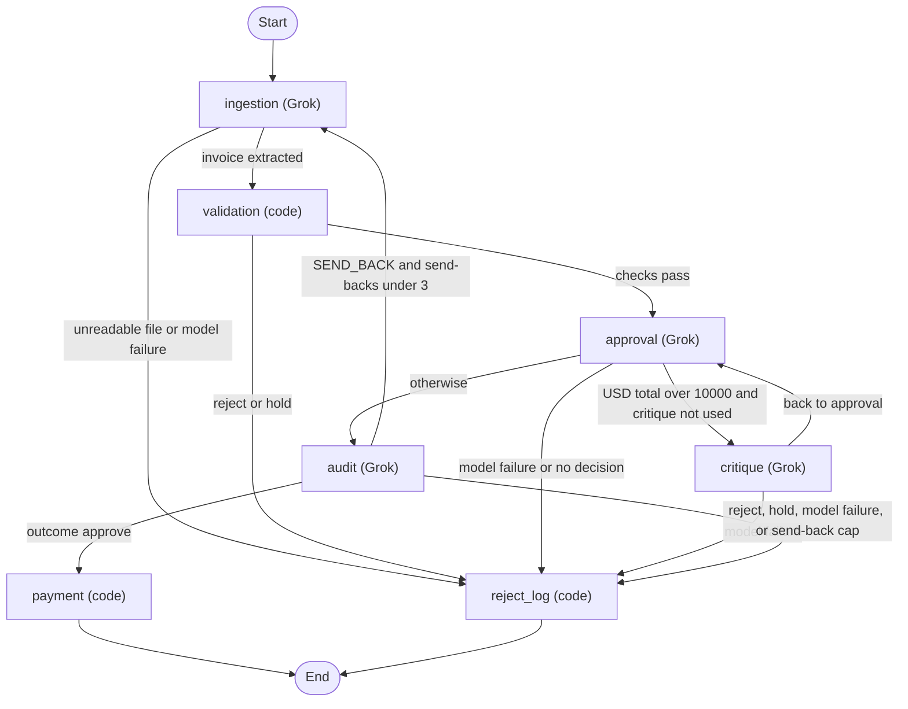

# Decision policy

Every invoice ends in one outcome: approve, reject, or hold. Every outcome carries a reason code and a plain-English reason. What each agent does, and how it fails, is in [Extended details](#extended-details).

The numbers live in [policy.toml](../policy.toml). `decision/policy.py` loads that file at startup. A missing key, a wrong type, or a nonsense value stops the process and names the key.

How each of Acme's manual steps is replaced, and who owns each kind of hold, is in the [README](../README.md#what-changes-for-acme).

## Agents

`graph.py` wires a LangGraph `StateGraph`. Each agent is a node. Ingestion, approval, critique, and audit call Grok. Validation, payment, and `reject_log` are code. Critique returns to approval. Audit can send the extraction back to ingestion. Holds and rejects both end at `reject_log`. Nothing on that path is paid. Payment runs only after an audit PASS on an approve.

## Key decisions

### Why code decides

Grok does the reading and the judging: it extracts the fields, lists the risks, critiques a large bill, and audits with tools. Code decides reject and approve. Within the warning band, the audit may turn an approve into a hold for a person. It does this by citing a fraud-signal or price-variance warning that code raised on this invoice, giving the innocent reading, and quoting page text that code verifies. So the same findings give the same outcome, except that an approve carrying one of those warnings may become a reviewer-releasable hold. The model can never cause a payment or a reject, and text inside an invoice cannot talk the system into paying it. Every answer stays traceable to a rule or to a quoted line. The trade-off is limited model autonomy. No invoice the pipeline rejected or held was paid in any run.

### Rules

- Code decides: reject wins over hold, hold wins over approve, and critique and audit can only tighten.
- Audit has tools that read inventory, totals, policy, and the ledger, cap at 3 rounds and 8 calls, and cannot pay.
- The same vendor and invoice number is a `DUPLICATE_INVOICE` hold, and a same-vendor cluster inside the split window that crosses the threshold is a `SPLIT_INVOICE` hold.
- Scored eval uses a fresh ledger per invoice, and `scripts/eval.py --ordered` shares one ledger.
- Replay runs this code on saved replies with no API key and no network, and a miss is a `SYSTEM_ERROR` hold that pays nothing.
- A non-USD invoice is a hold, and nothing is converted.
- Invoice 1003 is a stock reject, and its fraud signals stay on the record.
- Invoice 1004 approves: a non-commercial address on a clean invoice the brief lists as passing is a warning.

## Extended details

How each agent does its job, and how it fails.

Grok is `XAI_MODEL`, default `grok-4.20-0309-non-reasoning`, called through the OpenAI SDK at `https://api.x.ai/v1`. Temperature is 0.

### Ingestion

Grok extracts one JSON object from the file text. PDFs contribute their text layer. There is no network fetch. Code normalizes item names and the invoice number, and it copies each item name as printed.

An unreadable file is a reject, `UNREADABLE`. A model failure after the retries is a hold, `SYSTEM_ERROR`. Nothing is paid.

### Validation

Validation is Python. It checks required fields, quantities, unknown items, summed stock, line math within one cent, currency, revisions, credit notes, fraud wording, USD price spikes, and each item name against the source text.

A reject or a hold stops here and never reaches approval, critique, or audit. A ledger it cannot read is a `SYSTEM_ERROR` hold. A missing or empty source text is an `ITEM_NOT_IN_SOURCE` hold. An unknown item stays a reject. The reason adds "Likely meant X." only when exactly one inventory name is one letter away, and the item is never substituted.

### Approval

Approval does not choose the outcome. The decision is already approve, or hold when critique has made it stricter. Grok returns `risks_considered`. Python writes the rules, the evidence, and the conclusion.

A model failure, or no decision, goes to `reject_log` and is not paid. Wording that refuses the input or contradicts an approve, after the retries, is a `BAD_REASONING` hold and is not paid.

### Critique

Critique runs when the currency is USD, the total is over $10,000, and this pass has not been critiqued. A send-back resets that counter. The model returns concerns and a stricter flag. It can only turn an approve into a hold.

A model failure goes to `reject_log`. A concern that only restates the dollar threshold is dropped. The fact guard can set aside a covered-stock claim, a totals claim when the math already reconciles, or a future-date claim when that date is not after today.

### Audit

Grok returns PASS, SEND_BACK, or ESCALATE. Python will not loosen the result. A PASS on a reject still ends at `reject_log`. While send-backs are under 3, a SEND_BACK returns to ingestion. The fourth send-back is an `AUDIT_ESCALATED` hold.

An ESCALATE that cites only warning codes is dropped and logged as an `AUDIT_NOTE`, unless it carries a `warning_hold` that code accepts. The reply's `warning_hold` names one code, the innocent reading, a quote, and why the quote makes that reading unlikely. Code holds the invoice only when all of these are true:

- The code is `FRAUD_SIGNAL`, or `PRICE_VARIANCE` with at least one price above its reference. A price below its reference is never held.
- The code is in `cited_codes` and is a finding on this invoice.
- The innocent reading is not empty.
- The quote, with whitespace collapsed and case folded, is at least `audit_quote_min_chars` long and appears in the invoice text.
- The quote is not contained in a line that raised the warning. For a fraud signal that is the line the pattern matched. For a price it is the line that prints the above-reference price.

The hold is `AUDIT_ESCALATED` with the message `Audit held on CODE: "quote". why`. Its action is "Review the quoted text with the vendor, then release or keep the hold." A reviewer can release it. A failed check is kept in the `AUDIT_NOTE` with the reason, and the invoice is decided as if the audit had passed. The hold applies only to an approve. It never changes a reject or a hold, and the audit's other escalation paths are unchanged. `NEAR_THRESHOLD`, `DESCRIPTOR`, and `NONCOMMERCIAL_ADDRESS` are not eligible.

In the recorded run and three live runs of the warning set, the audit gave no `warning_hold`, so the code path has only been exercised by fake-model tests. The results are in [METRICS.md](METRICS.md) and [WARNING_ANSWER_KEY.md](WARNING_ANSWER_KEY.md).

Tools are capped at 3 rounds and 8 calls. A cap hit gets one final reply with no tools. If that reply fails, or any tool fails, the invoice is a `SYSTEM_ERROR` hold and nothing is paid. A replay miss is the same hold, and it does not call the network.

### Payment

Payment runs only with an unused authorization whose vendor, amount, and currency match the invoice. The mock prints `Paid {amount:.2f} to {vendor}` and returns success. Any other case is `not_paid`. A refused authorization adds `PAYMENT_REFUSED` and does not change the outcome. The unique index on vendor and invoice number blocks a second payment.

### Reject log

Reject log is the other exit. Rejects are logged as stage `reject_log`. Holds are logged as stage `hold`. The graph node is the same. The record includes the outcome, the reason code, the next action, and a `not_paid` payment row. A reject names what the vendor must resend. A hold names what a person does.

Reject log also writes a release record. A reviewer can pay a hold from that record only when every finding is a releasable hold or a warning. The rules are in [Releasing a hold](#releasing-a-hold).

### Tools, the ledger, and the fact guard

Audit is the only stage with tools. Critique is not given them.

The four tools are `lookup_item`, `recompute_totals`, `get_policy_rule`, and `check_payment_ledger`. They are read-only and bound to the current invoice. They do not open the database, and they do not pay. A hit on the ledger tool can add a `DUPLICATE_INVOICE` or `SPLIT_INVOICE` finding. A miss adds nothing. An identical repeat returns the earlier result, does not run the tool again, and does not count against the 8-call cap. The round still counts.

`check_payment_ledger` takes no arguments. It reports prior payments for this vendor and invoice number, plus that vendor's paid total inside the split window. Two workers, or a payment made outside this run, can write the ledger after validation and before audit. The tool reads that payment. In one process, validation already holds a duplicate or a split, so those invoices never reach the tool.

`payments.db` sits next to `inventory.db`. Only the payment step writes it. The match key is the vendor name, casefolded with whitespace collapsed, plus the normalized invoice number. `INV 1004` and `INV-1004` are the same number. The same raw text is the same match. A revision of a number that has not been paid is still only `REVISED_INVOICE`. After that original is paid, the revision is `DUPLICATE_INVOICE` and the revised-invoice finding stays. A name-order pass of `data/invoices` on one `payments.db` holds `invoice_1004_revised.json` after `invoice_1004.json` is paid (Precision Parts Ltd., INV-1004) and holds `invoice_1011.txt` after `invoice_1011.pdf` is paid (Summit Manufacturing Co., INV-1011, $3,000.00). The split window is 30 days. No sample file is a split. The row is reserved as `pending` inside the write lock, before the mock payment, so two writers cannot both pay. It becomes `paid` when the gateway confirms. If the gateway raises or does not confirm, the row becomes `failed` and the invoice is a `SYSTEM_ERROR` hold. A pending or failed row still blocks a second payment, because a failed call may have reached the bank. A person checks with the bank and clears it. `python3 main.py --reset-ledger` deletes `payments.db` before that one file.

Critique and audit receive the facts the code already checked: today's date, stock, whether the totals reconcile, the reference prices, and whether the dates are after today. On a critique, the guard sets aside a stock claim whose summed quantity is covered, a totals-mismatch claim when the totals already reconcile, and a future-date claim on the invoice date or the due date when that date is not after today. On an audit, the same future-date claim can be set aside. Every other concern is kept. A send-back stands while any feedback remains. An escalation does too, and either stands when the audit cites a finding code. Every set-aside is logged.

`invoice_2106.txt` is a clean $11,500 approve. The guard exists so a critique cannot hold that bill on a stock or date claim the code has already checked.

The reject, hold, and warning tables follow.

## Approve

Approve when all checks pass and there are no blocking findings.

A USD total over $10,000 gets one critique. That review can only make the decision stricter. Being over the threshold is not a risk finding by itself.

## Reject

Reject means the vendor must send something new. Every reject names that next step.

| Finding | Next step for the vendor |
|---|---|
| Missing required field (vendor, due date, line items, total) | Resend the invoice with the missing field filled in. |
| Quantity that is zero, negative, or not a number | Resend with corrected quantities. |
| Unknown item | Resend with the correct item name. Code adds "Likely meant X." only when exactly one inventory name is one letter away, after case, spaces, and hyphens are removed. The item is still rejected and is never substituted. |
| Stock shortfall | Resend for the quantity in stock, or amend the PO. |
| Total or line-math mismatch | Resend with corrected totals. |
| Unreadable file | Resend in a readable format. |
| Embedded instructions aimed at the system | Resend a clean invoice. Recorded as a security finding. |
| Negative amount that is not a labeled credit note | Resend with corrected amounts, or send a labeled credit note. |

Embedded instructions are rejected only when the model flags them and the text matches an imperative phrase aimed at the system. The phrase check looks for "ignore previous instructions" or "skip review". The bare word "approve" does not match. Ordinary invoices say things like "PO approved by".

## Hold

Hold when a person can do something the system cannot. Every hold names that action.

| Finding | Action for a person |
|---|---|
| Non-USD currency | Finance confirms the currency and amount. Nothing is converted and nothing is paid. |
| Duplicate invoice | Do not pay it again. The same vendor and invoice number are already in the payments ledger. |
| Split invoice | Do not pay it. This invoice is at or under the approval threshold, and with this vendor's other paid invoices inside the split window it is over that threshold. |
| Revised invoice | Confirm it replaces the original and that the original was not paid. |
| Labeled credit note whose math reconciles | Accounting applies the credit. Nothing is paid. |
| Renamed vendor | Verify it is the same company. |
| Two or more fraud signals together (urgency pressure, wire-only payment, a new remittance account) | Verify with the vendor using contact details already on file. |
| Unit price 50% or more above reference | Verify the price with the vendor. |
| Clean invoice over $10,000 with a new remittance or bank account | Verify the change with the vendor. A bank-account change is the most common invoice-fraud pattern. |
| Item name not in source text | Check the item name against the invoice. |
| Audit hold on a quoted fraud-signal or above-reference price warning | Review the quoted text with the vendor, then release or keep the hold. |
| Grok or system failure after retries | Rerun the invoice or process it by hand. Tracked as a system error, not a business decision. |

`DUPLICATE_INVOICE` and `SPLIT_INVOICE` read `payments.db`. Only the payment step writes it. The match key is the vendor name, casefolded with whitespace collapsed, plus the invoice number after normalization. The split window is `split_window_days`, 30 days. A date that does not parse is outside the window. Another vendor does not count. How the ledger behaves across files is in [Tools, the ledger, and the fact guard](#tools-the-ledger-and-the-fact-guard).

Compare `abs(unit_price)` with the reference price. If `abs(unit_price) >= reference * 1.50`, the invoice is a `PRICE_SPIKE` hold on its own. That spike is not a fraud signal. A smaller difference, including a price below the reference, stays a price-variance warning. A spike line still records that warning. Non-USD invoices are not price-checked. Reject still beats this hold.

An extracted item name that is not in the invoice text is an `ITEM_NOT_IN_SOURCE` hold. The text is the file for `.txt`, JSON, CSV, and XML, and the PDF text layer for a PDF. A missing or empty source fails closed. The name is not corrected, and nothing is paid.

## Warnings

Warnings are recorded and shown. On their own they do not change the outcome. The audit may turn an approve with a single fraud signal, or a price above reference, into a hold. See [Audit](#audit).

- A single fraud signal.
- A total within 2% under the $10,000 threshold, and still under it.
- A unit price that differs from the reference by less than 50%, compared on `abs(unit_price)`.
- A descriptor on an item name, such as "WidgetA (rush order)". The descriptor is split into a note and the item is matched as WidgetA.
- A non-commercial vendor address. It is never a hold by itself.

Item names are matched after normalizing case, spaces, and hyphens.

## Ground rules

- Reject wins over hold. Hold wins over approve. When a reject also has fraud signals or a hold, those findings stay in the reason.
- The model reads and flags. Code decides. The same findings always give the same outcome, except that the audit may turn an approve with a fraud-signal or above-reference price warning into a hold, with a quote code has verified. This keeps every payment traceable to a rule, and it means text inside an invoice cannot loosen a decision. The reasoning is in [Why code decides](#why-code-decides).
- Each invoice is judged on its own facts plus the payments ledger. The ledger can only add a hold. Scored eval gives each invoice a fresh ledger, so a scored result does not depend on order.
- An OCR number fix is kept only when the math reconciles. An O read as a 0 in an amount or a date is fixed only when the lines and totals add up afterwards.
- No payment without an audit PASS, or a reviewer release of a payable hold.
- Non-USD is never paid. Nothing is converted.
- Critique and audit can only tighten. Critique sets aside a stock claim whose summed quantity is covered by available stock, a totals-mismatch claim when the totals reconcile, and a future-date claim on the invoice date or the due date when that date is not after today. Audit sets aside that same future-date claim. Every other concern is kept, including a disagreement between the raw text and the extraction. A send-back stands while any feedback remains. An escalation does too, and either stands when the audit cites a finding code. Every set-aside is logged.

Invoice 1003 is a reject for the stock shortfall. Its urgency and wire-transfer signals stay on the record. Invoice 1004 approves. A non-commercial address on a clean invoice the brief lists as passing is a warning. The revised file stays a hold because it is a revision.

## Releasing a hold

`approve_and_pay` in `pipeline/approve_hold.py` is how a reviewer pays a held invoice. The pipeline outcome stays what the run recorded. Each decision is appended to a log and is not written back over that outcome.

`PAYABLE_HOLD_CODES` in `decision/outcome.py` lists the holds a person may release: `REVISED_INVOICE`, `VENDOR_RENAMED`, `NEW_REMITTANCE`, `FRAUD_CLUSTER`, `PRICE_SPIKE`, `CRITIQUE_HOLD`, and `AUDIT_ESCALATED`. A hold is payable only when every saved finding and every fresh finding is one of those codes or a warning. Two fraud signals count as the fraud-cluster hold. `AUDIT_ESCALATED` is not payable when `send_back_cap` is set or the recorded message is the send-back cap sentence.

A reject is never paid. Neither is a hold with a reject-class finding, or a closed hold: `ITEM_NOT_IN_SOURCE`, `NON_USD`, `CREDIT_NOTE`, `DUPLICATE_INVOICE`, `SPLIT_INVOICE`, `SYSTEM_ERROR`, or `BAD_REASONING`. The total must be greater than zero, the currency must be USD, and the amount must equal the recorded total. An OCR number such as `INV 1O12` stays held.

A release re-checks the live source file and the live inventory without the model. Matching the vendor, invoice number, total, and each line's name and quantity is a sanity check. Text already in the file passes, so that check does not show the record is unchanged. Before the release file is written, the run stores its sha256 in `payments.db` when the outcome is a payable hold, or NULL otherwise. Approval pays only when the file's sha256 equals that row.

The split and same-text checks run at validation, and the payment write checks them again inside the ledger lock. A second writer sees the first row, so two processes cannot each pay half of a split.

## Knobs

| Knob | Value | What it does |
|---|---|---|
| `scrutiny_threshold` | 10000 | A USD total strictly over this goes to critique once. Being over it is not a risk by itself. |
| `critique_cap` | 1 | One critique pass, then approval again. |
| `audit_send_back_cap` | 3 | The audit can send the extraction back three times. The next send-back becomes a hold. |
| `allowed_currencies` | USD | Any other currency is a hold. Nothing is converted. |
| `money_tolerance` | 0.01 | Line math must match the printed total within one cent. |
| `model_retry_attempts` | 5 | Then the invoice is a `SYSTEM_ERROR` hold and is not paid. `XAI_MAX_ATTEMPTS` can override one run. |
| `near_threshold_ratio` | 0.02 | A total within 2% under the threshold, and still under it, is a warning. |
| `price_spike_ratio` | 0.50 | `abs(unit_price)` at least 50% above the USD reference is a `PRICE_SPIKE` hold. |
| `reference_prices` | WidgetA 250, WidgetB 500, GadgetX 750 | USD references. A smaller gap stays a price-variance warning. |
| `split_window_days` | 30 | Same vendor, printed dates inside this window. |
| `audit_quote_min_chars` | 12 | The shortest quote, after normalizing, that an audit warning hold may rest on. |

Retries back off 1, 2, 4, 8, then 16 seconds, plus up to 25% jitter. After those attempts, or on HTTP 400, 401, or 403, the invoice is a `SYSTEM_ERROR` hold and nothing is paid.

Reference prices live in `policy.toml`. The inventory table stays the four seed rows: WidgetA 15, WidgetB 10, GadgetX 5, FakeItem 0. Approving an invoice does not decrease stock.

Stock stays fixed so that each invoice is judged on its own facts, the same way the answer keys were written. If an approve drew stock down, an outcome would depend on which files ran first. After invoice 1001 (WidgetA 10) and invoice 1006 (WidgetA 5), WidgetA would be 0, and invoice 1010 (WidgetA 12) would turn from an approve into a stock reject. Replay, the live runs, and scored eval each expect one result per file, whatever ran before it. The payments ledger is the only state carried across files, and it can only add a hold.

## Limitations

- The fact guard trusts the category on the model's claim. A stock sentence labeled `other` is kept.
- A `failed` ledger row blocks that invoice until a person removes it. There is no tool for that yet; it is a manual edit of `payments.db` after checking with the bank. A process killed between the reserve and the settle leaves a `pending` row, which blocks the same way.
- One reviewer can release `FRAUD_CLUSTER` or `NEW_REMITTANCE`. A second approver for vendor-risk holds is the production next step.
- `logs/` is trusted the same way `payments.db` is. Anyone who can edit those files can edit the ledger.
- Split detection is unit-tested on synthetic invoices only. No sample file is a split.
- Non-USD invoices are never converted.
- Stock is the four seed rows, opened read-only, and it does not move when a bill is approved.
- The audit can only weigh warnings code already raised, and fraud signals come from keyword patterns. A payment redirection with no keywords, such as "settlement to the account on the attached remittance advice", raises no `FRAUD_SIGNAL`, so it is never eligible for a warning hold. A follow-up could let extraction raise its own flag for code to check.
- In every run so far the audit gave no warning hold, so the two labeled warning holds, 2121 and 2122, were paid. The prompt was not changed to chase those labels.
